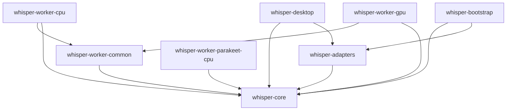

Avancée : relevé statique actualisé au 31 octobre 2026.
Blocage : exécution native et outils absents [Non vérifié].
Décision : description de l’existant, sans proposition de transformation.

# Cartographie du dépôt Whisper

## 1. Vue d’ensemble

- Huit crates sont déclarées dans `Cargo.toml:1-11`.
- Le desktop compose l’application et ouvre eframe/Glow. `crates/whisper-desktop/src/main.rs:5-33` ; `crates/whisper-desktop/src/lib.rs:18-56`.
- Le cœur route les commandes ; adapters exécute les effets. `crates/whisper-core/src/application/runtime/commands.rs:92-140` ; `crates/whisper-adapters/src/worker_ipc/runtime/effects.rs:4-236`.
- Les workers Turbo partagent le décodage et les services de worker-common. `crates/whisper-worker-cpu/src/decoder.rs:1-29` ; `crates/whisper-worker-gpu/src/decoder.rs:1-29` ; `crates/whisper-worker-common/src/lib.rs:1-5`.
- Parakeet utilise un autre protocole et un backend conditionnel. `crates/whisper-core/src/parakeet_ipc.rs:1-130` ; `crates/whisper-worker-parakeet-cpu/src/gpu_identity.rs:25-34`.
- L’import UI ajoute à la file ; Traiter et Reprendre sont explicites. `crates/whisper-desktop/src/ui/model/controller/actions.rs:61-101` ; `crates/whisper-desktop/src/ui/model/view/queue.rs:4-76`.
- Des chemins live direct, historique et unifié sont présents. `crates/whisper-adapters/src/worker_ipc/runtime/live.rs:1082-1168` ; `crates/whisper-adapters/src/worker_ipc/runtime/live.rs:1169-1244`.
- Bootstrap possède un point d’entrée de dix lignes. `crates/whisper-bootstrap/src/main.rs:1-10`.
- 339 fichiers Rust : 58664 lignes physiques production et 65487 tests ; [sources par fichier](raw/files.tsv).

## 2. Graphe des crates

Flèche : consommateur → dépendance interne normale déclarée ; packages confirmés par [metadata brut](raw/cargo-metadata.stdout.jsonl). Sources : `crates/whisper-core/Cargo.toml:1-12` ; `crates/whisper-adapters/Cargo.toml:1-38` ; `crates/whisper-worker-common/Cargo.toml:1-21` ; `crates/whisper-worker-cpu/Cargo.toml:1-23` ; `crates/whisper-worker-gpu/Cargo.toml:1-29` ; `crates/whisper-worker-parakeet-cpu/Cargo.toml:1-26` ; `crates/whisper-desktop/Cargo.toml:1-19` ; `crates/whisper-bootstrap/Cargo.toml:1-13`. Conditions et autres groupes dans les fiches.

## 3. Tableau des crates

| Nom | Type | Rôle et source | Lignes prod | Lignes tests |
| --- | --- | --- | --- | --- |
| whisper-core | Bibliothèque de domaine et application | Définit commandes, vues et ports et transforme les commandes en effets. `crates/whisper-core/src/application/contracts.rs:1-318` ; `crates/whisper-core/src/application/runtime/commands.rs:1-145` ; `crates/whisper-core/src/ports.rs:1-873` ; `crates/whisper-core/src/compute_policy.rs:1-67` ; `crates/whisper-core/src/parakeet_scheduler.rs:1-672` | 11251 | 8561 |
| whisper-adapters | Bibliothèque d’adaptateurs | Exécute les effets avec capture, archives et transport vers les workers. `crates/whisper-adapters/src/worker_ipc/runtime/effects.rs:1-237` ; `crates/whisper-adapters/src/capture.rs:1-1186` ; `crates/whisper-adapters/src/archive/publication.rs:1-291` ; `crates/whisper-adapters/src/worker_ipc/service/mod.rs:1-812` | 35016 | 45547 |
| whisper-worker-common | Bibliothèque de support des workers | Fournit décodage audio, MP3, trames JSON et vérification SHA-256. `crates/whisper-worker-common/src/decoder.rs:1-438` ; `crates/whisper-worker-common/src/encoder.rs:1-61` ; `crates/whisper-worker-common/src/ipc.rs:1-111` ; `crates/whisper-worker-common/src/integrity.rs:1-22` ; `crates/whisper-worker-common/src/observation.rs:1-4` | 631 | 753 |
| whisper-worker-cpu | Worker binaire CPU | Lit les commandes IPC et exécute import, live ou décodage. `crates/whisper-worker-cpu/src/startup.rs:1-86` ; `crates/whisper-worker-cpu/src/session/mod.rs:1-169` ; `crates/whisper-worker-cpu/src/engine_cache.rs:1-23` ; `crates/whisper-worker-cpu/src/native_engine.rs:1-196` ; `crates/whisper-worker-cpu/src/session/import.rs:1-293` | 1751 | 958 |
| whisper-worker-gpu | Worker binaire CUDA | Exécute import, live, décodage et qualification GPU depuis le protocole IPC. `crates/whisper-worker-gpu/src/session/mod.rs:1-335` ; `crates/whisper-worker-gpu/src/gpu_commands.rs:1-100` ; `crates/whisper-worker-gpu/src/native_engine.rs:1-120` ; `crates/whisper-worker-gpu/src/gpu_attestation.rs:1-90` | 2843 | 1320 |
| whisper-worker-parakeet-cpu | Worker binaire Parakeet, backend conditionnel | Charge Parakeet depuis ses bibliothèques natives puis traite son protocole IPC. `crates/whisper-worker-parakeet-cpu/src/startup.rs:1-71` ; `crates/whisper-worker-parakeet-cpu/src/session.rs:1-233` ; `crates/whisper-worker-parakeet-cpu/src/native_ffi.rs:1-410` ; `crates/whisper-worker-parakeet-cpu/src/gpu_identity.rs:1-174` ; `crates/whisper-worker-parakeet-cpu/src/decode_only.rs:1-49` | 1877 | 3407 |
| whisper-desktop | Binaire et bibliothèque de présentation | Compose application et adaptateurs puis ouvre une fenêtre eframe/Glow. `crates/whisper-desktop/src/main.rs:1-33` ; `crates/whisper-desktop/src/root.rs:1-1656` ; `crates/whisper-desktop/src/lib.rs:1-56` ; `crates/whisper-desktop/src/ui/model/controller/actions.rs:1-353` ; `crates/whisper-desktop/src/ui/model/view.rs:1-51` | 5285 | 4941 |
| whisper-bootstrap | Binaire | Construit une vue par défaut et référence la version IPC et le type du transport. `crates/whisper-bootstrap/src/main.rs:1-10` | 10 | 0 |

Lignes physiques : vides/commentaires inclus. Tests externes héritant du `cfg(test)` du déclarant ; features de recette hors tests. [Méthode](raw/METHOD.md).

## 4. Carte des modules par crate

### [whisper-core](crates/whisper-core.md)

| Module/cible | Responsabilité et source | Prod | Tests |
| --- | --- | --- | --- |
| crate::application::contracts | Définit AppCommand, AppView, Application, AppFacade et les phases capture/moteur. `crates/whisper-core/src/application/contracts.rs:1-318` | 318 | 0 |
| crate::application::event_metadata | Associe les variantes ImportEvent à un nom et une identité job/génération. `crates/whisper-core/src/application/event_metadata.rs:1-170` | 170 | 0 |
| crate::application::runtime::automatic_final | Suit l’import final automatique et sa persistance jusqu’à publication. `crates/whisper-core/src/application/runtime/automatic_final.rs:1-381` | 381 | 0 |
| crate::application::runtime::closing | Pilote la demande de fermeture, les retraits de file et les arrêts actifs. `crates/whisper-core/src/application/runtime/closing.rs:1-184` | 184 | 0 |
| crate::application::runtime::commands | Vérifie l’admission des modèles et route les commandes Application. `crates/whisper-core/src/application/runtime/commands.rs:1-145` | 145 | 0 |
| crate::application::runtime::events | Route les événements import, micro, capture et finalisation. `crates/whisper-core/src/application/runtime/events.rs:1-130` | 130 | 0 |
| crate::application::runtime::import | Gère préparation, segments, acquittements, publication et reprise import. `crates/whisper-core/src/application/runtime/import.rs:1-515` | 515 | 0 |
| crate::application::runtime::live | Traite commandes/événements live, compteurs audio et finalisation CPU. `crates/whisper-core/src/application/runtime/live.rs:1-720` | 720 | 0 |
| crate::application::runtime::microphone | Gère commandes/événements de test microphone et de gain. `crates/whisper-core/src/application/runtime/microphone.rs:1-370` | 370 | 0 |
| crate::application::runtime | Porte l’état ImportApplication et construit files, compteurs et vues. `crates/whisper-core/src/application/runtime/mod.rs:1-150` | 140 | 10 |
| crate::application::runtime::parakeet_views | Actualise les cartes de captures Parakeet et leurs textes/états. `crates/whisper-core/src/application/runtime/parakeet_views.rs:1-572` | 572 | 0 |
| crate::application::runtime::poll | Draine les événements du port et les segments en attente au rafraîchissement. `crates/whisper-core/src/application/runtime/poll.rs:1-45` | 45 | 0 |
| crate::application::runtime::queue | Traite file, historique, doublons, admissions et résolutions explicites. `crates/whisper-core/src/application/runtime/queue.rs:1-476` | 476 | 0 |
| crate::application::runtime::tests | Tests ou supports : définit `close_blocks_direct_and_indirect_admissions_without_submitting_effects` `crates/whisper-core/src/application/runtime/tests/closing_and_recovery.rs:27-116`, `empty_snapshot_recovery_inspection_closes_dialog_and_reports_result` `crates/whisper-core/src/application/runtime/tests/closing_and_recovery.rs:119-133`. | 0 | 313 |
| crate::application::runtime::tests | Tests ou supports : définit `repeated_start_is_identifiable_and_stale_stop_does_not_target_new_generation` `crates/whisper-core/src/application/runtime/tests/live_lifecycle.rs:2-24`, `every_job_lifecycle_command_carries_identity` `crates/whisper-core/src/application/runtime/tests/live_lifecycle.rs:27-87`. | 0 | 765 |
| crate::application::runtime::tests | Tests ou supports : définit `parakeet_provisional_never_becomes_confirmed_without_a_confirmed_event` `crates/whisper-core/src/application/runtime/tests/parakeet_sessions.rs:2-78`, `parakeet_automatic_final_import_stays_unverified_and_separate_from_confirmed_text` `crates/whisper-core/src/application/runtime/tests/parakeet_sessions.rs:81-383`. | 0 | 954 |
| crate::application::runtime::tests | Tests ou supports : définit `unified_page_responses_and_errors_follow_latest_selection_request` `crates/whisper-core/src/application/runtime/tests/selection_and_microphone.rs:2-216`, `unified_session_card_cache_stays_bounded_at_eight` `crates/whisper-core/src/application/runtime/tests/selection_and_microphone.rs:219-243`. | 0 | 1146 |
| crate::application::runtime::tests | Tests ou supports : déclare les sous-modules/réexportations de `crates/whisper-core/src/application/runtime/tests.rs:1-4`. | 0 | 4 |
| crate::application::runtime::unified | Projette sessions unifiées, pages document/audio et commandes de capture. `crates/whisper-core/src/application/runtime/unified.rs:1-1128` | 1128 | 0 |
| crate::application | Réexporte contrats et ImportApplication depuis ses modules privés. `crates/whisper-core/src/application.rs:1-9` | 9 | 0 |
| crate::audio | Reconnaît les fins audio courtes et silencieuses par calcul d’énergie. `crates/whisper-core/src/audio.rs:1-45` | 26 | 19 |
| crate::compute_policy | Décide le backend initial et les suites permises après son échec. `crates/whisper-core/src/compute_policy.rs:1-67` | 67 | 0 |
| crate::domain | Définit identités, générations, plages audio et transitions JobState. `crates/whisper-core/src/domain.rs:1-170` | 122 | 48 |
| crate::engine_capabilities | Projette et valide les combinaisons moteurs, modèles et capacités. `crates/whisper-core/src/engine_capabilities.rs:1-527` | 527 | 0 |
| crate::gpu_inventory | Qualifie et normalise observations et identités GPU. `crates/whisper-core/src/gpu_inventory.rs:1-341` | 341 | 0 |
| crate::gpu_inventory_app | Suit une collecte GPU via un port et expose son état et sa sélection. `crates/whisper-core/src/gpu_inventory_app.rs:1-248` | 248 | 0 |
| crate::gpu_selection | Résout les préférences GPU et vérifie les attestations du candidat. `crates/whisper-core/src/gpu_selection.rs:1-204` | 204 | 0 |
| crate::ipc | Définit enveloppes, commandes et événements du protocole Turbo. `crates/whisper-core/src/ipc.rs:1-343` | 326 | 17 |
| crate | Déclare les modules et interfaces de bibliothèque. `crates/whisper-core/src/lib.rs:1-45` | 45 | 0 |
| crate::microphone | Définit le port microphone et conserve choix préféré/effectif et notifications. `crates/whisper-core/src/microphone.rs:1-247` | 161 | 86 |
| crate::microphone_level | Définit gain, identités/révisions, mesures de niveau et de spectre. `crates/whisper-core/src/microphone_level.rs:1-628` | 548 | 80 |
| crate::model_catalog | Définit identités, disponibilités et observations de modèles. `crates/whisper-core/src/model_catalog.rs:1-50` | 50 | 0 |
| crate::model_registry | Déclare les modèles et construit leurs clés de configuration. `crates/whisper-core/src/model_registry.rs:1-345` | 345 | 0 |
| crate::model_selection_app | Valide les demandes import/live contre catalogue et capacités. `crates/whisper-core/src/model_selection_app.rs:1-313` | 313 | 0 |
| crate::parakeet_ipc | Définit commandes, événements, identité et preuves GPU du protocole Parakeet. `crates/whisper-core/src/parakeet_ipc.rs:1-130` | 130 | 0 |
| crate::parakeet_scheduler | Ordonne les appels preview/final et suit admission, exécution et recyclage. `crates/whisper-core/src/parakeet_scheduler.rs:1-672` | 424 | 248 |
| crate::parakeet_session | Définit stratégies et transitions des frontières/fenêtres de session. `crates/whisper-core/src/parakeet_session.rs:1-433` | 309 | 124 |
| crate::parakeet_windows | Planifie les fenêtres et convertit les temps des mots en échantillons absolus. `crates/whisper-core/src/parakeet_windows.rs:1-333` | 273 | 60 |
| crate::path_settings | Restaure et mémorise chemins et préférences au travers de ports. `crates/whisper-core/src/path_settings.rs:1-851` | 616 | 235 |
| crate::ports | Définit les ports et données échangées par effets et événements. `crates/whisper-core/src/ports.rs:1-873` | 873 | 0 |
| integration::application_routing | Tests ou supports : définit `legacy_start_live_is_rejected_without_effects` `crates/whisper-core/tests/application_routing.rs:30-46`, `history_event_is_applied_without_an_active_job` `crates/whisper-core/tests/application_routing.rs:49-70`. | 0 | 70 |
| integration::compute_policy | Tests ou supports : définit `forced_cpu_never_selects_or_initializes_gpu` `crates/whisper-core/tests/compute_policy.rs:6-15`, `auto_uses_gpu_when_available_and_allows_only_gpu_to_cpu_fallback` `crates/whisper-core/tests/compute_policy.rs:18-47`. | 0 | 63 |
| integration::engine_capabilities | Tests ou supports : définit `auto_and_manual_language_are_independent_and_projection_matches_admission` `crates/whisper-core/tests/engine_capabilities.rs:115-224`, `no_admissible_language_mode_refuses_launch_and_unknown_is_not_unsupported` `crates/whisper-core/tests/engine_capabilities.rs:227-291`. | 0 | 718 |
| integration::gpu_inventory | Tests ou supports : définit `inventory_keeps_homonymous_devices_and_excludes_confirmed_absence` `crates/whisper-core/tests/gpu_inventory.rs:36-49`, `current_device_with_missing_properties_is_kept_as_unknown` `crates/whisper-core/tests/gpu_inventory.rs:52-66`. | 0 | 400 |
| integration::gpu_selection | Tests ou supports : définit `default_uses_windows_rank_even_when_motor_order_and_names_are_reversed` `crates/whisper-core/tests/gpu_selection.rs:45-76`, `preferred_compatible_device_wins_without_rank_and_missing_rank_never_becomes_default` `crates/whisper-core/tests/gpu_selection.rs:79-93`. | 0 | 297 |
| integration::import_contract | Tests ou supports : définit `application_keeps_bounded_strategy_in_prepare_and_start_effects` `crates/whisper-core/tests/import_contract.rs:49-72`, `application_publishes_only_after_end_and_synced_segment_receipt` `crates/whisper-core/tests/import_contract.rs:75-168`. | 0 | 902 |
| integration::live_contract | Tests ou supports : définit `starting_live_emits_one_explicit_effect_and_initializes_separate_counters` `crates/whisper-core/tests/live_contract.rs:47-76`, `forced_gpu_recovery_requires_an_explicit_cpu_finish_command` `crates/whisper-core/tests/live_contract.rs:79-109`. | 0 | 233 |
| integration::microphone_level | Tests ou supports : définit `spectrum_context_binds_source_and_rejects_stale_foreign_and_future_updates` `crates/whisper-core/tests/microphone_level.rs:13-81`, `retry_barrier_rejects_same_owner_spectrum_acquired_before_cpu_retry` `crates/whisper-core/tests/microphone_level.rs:84-140`. | 0 | 238 |
| integration::model_catalog | Tests ou supports : définit `catalog_is_closed_to_the_two_planned_model_identities` `crates/whisper-core/tests/model_catalog.rs:61-68`, `configuration_identity_includes_every_qualification_dimension` `crates/whisper-core/tests/model_catalog.rs:71-115`. | 0 | 242 |
| integration::model_preferences | Tests ou supports : définit `turbo_is_default_and_user_model_and_auto_preferences_are_saved_with_revisions` `crates/whisper-core/tests/model_preferences.rs:51-71`, `failed_or_stale_preference_ack_is_reported_without_reverting_the_session_choice` `crates/whisper-core/tests/model_preferences.rs:74-99`. | 0 | 120 |
| integration::model_selection_app | Tests ou supports : définit `turbo_existing_matrix_admits_all_1206_inputs_without_native_inference` `crates/whisper-core/tests/model_selection_app.rs:20-61`, `turbo_existing_matrix_admits_and_submits_all_1206_guard_requests` `crates/whisper-core/tests/model_selection_app.rs:64-144`. | 0 | 430 |
| integration::parakeet_import_contract | Tests ou supports : définit `only_qualified_cpu_import_with_automatic_language_is_admitted` `crates/whisper-core/tests/parakeet_import_contract.rs:71-119`, `parakeet_import_admits_long_product_input_but_rejects_wrong_hash` `crates/whisper-core/tests/parakeet_import_contract.rs:122-136`. | 0 | 278 |
| integration::parakeet_ipc | Tests ou supports : définit `parakeet_protocol_is_versioned_and_caps_are_explicit` `crates/whisper-core/tests/parakeet_ipc.rs:8-13`, `transcribe_command_carries_complete_build_runtime_profile_and_attempt_identity` `crates/whisper-core/tests/parakeet_ipc.rs:16-49`. | 0 | 113 |
| integration::parakeet_windows | Tests ou supports : définit `silence_threshold_and_minimum_duration_are_inclusive` `crates/whisper-core/tests/parakeet_windows.rs:18-31`, `chooses_earliest_of_equal_distance_silences_near_ninety_seconds` `crates/whisper-core/tests/parakeet_windows.rs:34-45`. | 0 | 194 |
| integration::scheduler_contract | Tests ou supports : définit `admission_and_restoration_never_start_a_worker_without_user_choice` `crates/whisper-core/tests/scheduler_contract.rs:43-77`, `enqueue_is_acknowledged_only_after_the_durable_queue_event` `crates/whisper-core/tests/scheduler_contract.rs:80-114`. | 0 | 154 |

Modules inline (sous-ensembles non additionnables) :

| Module | Responsabilité déclarative | Prod | Tests | Source |
| --- | --- | --- | --- | --- |
| tests | tests/auxiliaires | 0 | 19 | `crates/whisper-core/src/audio.rs:27-45` |
| tests | tests/auxiliaires | 0 | 48 | `crates/whisper-core/src/domain.rs:123-170` |
| tests | tests/auxiliaires | 0 | 17 | `crates/whisper-core/src/ipc.rs:327-343` |
| tests | tests/auxiliaires | 0 | 86 | `crates/whisper-core/src/microphone.rs:162-247` |
| tests | tests/auxiliaires | 0 | 80 | `crates/whisper-core/src/microphone_level.rs:549-628` |
| tests | tests/auxiliaires | 0 | 248 | `crates/whisper-core/src/parakeet_scheduler.rs:425-672` |
| tests | tests/auxiliaires | 0 | 124 | `crates/whisper-core/src/parakeet_session.rs:310-433` |
| tests | tests/auxiliaires | 0 | 60 | `crates/whisper-core/src/parakeet_windows.rs:274-333` |
| microphone_tests | tests/auxiliaires | 0 | 235 | `crates/whisper-core/src/path_settings.rs:617-851` |

### [whisper-adapters](crates/whisper-adapters.md)

| Module/cible | Responsabilité et source | Prod | Tests |
| --- | --- | --- | --- |
| crate::archive::campaign | Contient barrières et marqueurs de campagne conditionnés par recette-hooks. `crates/whisper-adapters/src/archive/campaign.rs:1-484` | 484 | 0 |
| crate::archive::cleanup::execution | Exécute les suppressions de remplacement après contrôle des identités et chemins. `crates/whisper-adapters/src/archive/cleanup/execution.rs:1-561` | 561 | 0 |
| crate::archive::cleanup::proofs | Relève les identités des fichiers et conteneurs contrôlés lors du retrait. `crates/whisper-adapters/src/archive/cleanup/proofs.rs:1-569` | 569 | 0 |
| crate::archive::cleanup | Lit/écrit les plans de retrait des traitements remplacés et permet leur reprise. `crates/whisper-adapters/src/archive/cleanup.rs:1-220` | 220 | 0 |
| crate::archive::identity | Valide identités/artefacts d’archives et lit les pages document/audio unifiées. `crates/whisper-adapters/src/archive/identity.rs:1-877` | 877 | 0 |
| crate::archive::import | Prépare les générations import, sources segmentées et confirmations VAD. `crates/whisper-adapters/src/archive/import.rs:1-517` | 517 | 0 |
| crate::archive::journal | Persiste et relit les segments et valide le préfixe de reprise. `crates/whisper-adapters/src/archive/journal.rs:1-308` | 308 | 0 |
| crate::archive::live | Persiste paquets MP3, tentatives et fenêtres live puis publie les artefacts. `crates/whisper-adapters/src/archive/live.rs:1-714` | 714 | 0 |
| crate::archive::publication::catalog | Gère index, réservations, doublons et intentions de publication. `crates/whisper-adapters/src/archive/publication/catalog.rs:1-1082` | 1082 | 0 |
| crate::archive::publication::exports | Installe les exports et vérifie leur propriété et identité de fichier. `crates/whisper-adapters/src/archive/publication/exports.rs:1-623` | 615 | 8 |
| crate::archive::publication | Prépare puis engage la publication d’une génération import. `crates/whisper-adapters/src/archive/publication.rs:1-291` | 287 | 4 |
| crate::archive::recovery::live | Scanne générations live/préfixes confirmés et réconcilie les alias. `crates/whisper-adapters/src/archive/recovery/live.rs:1-405` | 405 | 0 |
| crate::archive::recovery | Scanne les générations et prépare la reprise depuis un préfixe vérifié. `crates/whisper-adapters/src/archive/recovery.rs:1-752` | 752 | 0 |
| crate::archive::source | Identifie et empreinte les sources simples/segmentées et mesure leur durée. `crates/whisper-adapters/src/archive/source.rs:1-198` | 198 | 0 |
| crate::archive::storage | Écrit, copie et synchronise des fichiers nouveaux ou remplacés. `crates/whisper-adapters/src/archive/storage.rs:1-66` | 66 | 0 |
| crate::archive::tests | Tests ou supports : définit `recette_policy_l04_requires_the_feature` `crates/whisper-adapters/src/archive/tests/archive_and_contracts.rs:6-14`, `bounded_resume_accepts_a_current_backend_for_the_same_model_profile` `crates/whisper-adapters/src/archive/tests/archive_and_contracts.rs:17-27`. | 0 | 715 |
| crate::archive::tests | Tests ou supports : définit `l04_campaign_gate_rejects_escape_and_duplicate_trigger` `crates/whisper-adapters/src/archive/tests/campaign.rs:3-146`. | 0 | 146 |
| crate::archive::tests | Tests ou supports : définit `archive_characterization_truncated_cleanup_plan_is_refused_without_disposition` `crates/whisper-adapters/src/archive/tests/cleanup_characterization.rs:2-26`. | 0 | 26 |
| crate::archive::tests | Tests ou supports : définit `archive_characterization_ownership_versions_one_two_three_follow_existing_paths` `crates/whisper-adapters/src/archive/tests/export_ownership_characterization.rs:14-55`, `archive_characterization_ownership_truncated_or_unknown_refuses_without_mutation` `crates/whisper-adapters/src/archive/tests/export_ownership_characterization.rs:58-94`. | 0 | 262 |
| crate::archive::tests | Tests ou supports : définit `archive_characterization_stream_error_keeps_final_and_retry_replaces_it` `crates/whisper-adapters/src/archive/tests/publication_characterization.rs:78-100`, `archive_characterization_replace_obstacle_keeps_temporary_until_retry` `crates/whisper-adapters/src/archive/tests/publication_characterization.rs:103-126`. | 0 | 335 |
| crate::archive | Tests ou supports : définit `inject_copy_fallback_publication_cut` `crates/whisper-adapters/src/archive/tests/publication_support.rs:20-25`, `clear_copy_fallback_publication_cut` `crates/whisper-adapters/src/archive/tests/publication_support.rs:28-32`. | 0 | 59 |
| crate::archive::tests | Tests ou supports : définit `r7_copy_fallback_recovers_between_exports_without_clobbering_a_byte_identical_collision` `crates/whisper-adapters/src/archive/tests/recovery.rs:2-327`, `segment_recovery_keeps_synced_prefix_and_drops_only_a_partial_tail` `crates/whisper-adapters/src/archive/tests/recovery.rs:330-351`. | 0 | 847 |
| crate::archive::tests | Tests ou supports : définit `archive_characterization_pending_absent_truncated_and_divergent` `crates/whisper-adapters/src/archive/tests/recovery_characterization.rs:2-40`, `archive_characterization_segment_journal_repairs_initial_and_large_partial_tail` `crates/whisper-adapters/src/archive/tests/recovery_characterization.rs:43-64`. | 0 | 85 |
| crate::archive::tests | Tests ou supports : définit `r11_replace_deactivates_every_matching_publication_and_keeps_other_audio` `crates/whisper-adapters/src/archive/tests/replacement_and_segmented.rs:2-87`, `r11_create_new_preserves_existing_publications_and_index_write_is_atomic` `crates/whisper-adapters/src/archive/tests/replacement_and_segmented.rs:90-135`. | 0 | 413 |
| crate::archive::tests | Tests ou supports : déclare les sous-modules/réexportations de `crates/whisper-adapters/src/archive/tests.rs:1-8`. | 0 | 8 |
| crate::archive | Définit ArchiveStore/LiveArchive et distribue leurs implémentations dans les sous-modules. `crates/whisper-adapters/src/archive.rs:1-581` | 566 | 15 |
| crate::capture | Ouvre les entrées microphone et convertit les blocs avec compensation et gain. `crates/whisper-adapters/src/capture.rs:1-1186` | 691 | 495 |
| crate::decoder | Valide une demande de décodage et la transmet par WorkerTransport. `crates/whisper-adapters/src/decoder.rs:1-251` | 103 | 148 |
| crate::direct_live::capture | Draine les blocs capturés et publie les mesures niveau/spectre. `crates/whisper-adapters/src/direct_live/capture.rs:1-148` | 148 | 0 |
| crate::direct_live::d2_corpus | Tests ou supports : définit `d2_corpus_real_cpu_turbo_and_parakeet` `crates/whisper-adapters/src/direct_live/d2_corpus.rs:143-282`, `d2_frame_deadlines_follow_the_monotone_one_x_sample_clock` `crates/whisper-adapters/src/direct_live/d2_corpus.rs:455-468`. | 0 | 622 |
| crate::direct_live::outputs | Écrit les exports texte/SRT et les manifestes capture/finalisation Parakeet. `crates/whisper-adapters/src/direct_live/outputs.rs:1-267` | 267 | 0 |
| crate::direct_live::test_support | Tests ou supports : définit `from_test_capture` `crates/whisper-adapters/src/direct_live/test_support.rs:5-53`, `from_test_capture_with_cpu_worker` `crates/whisper-adapters/src/direct_live/test_support.rs:56-110`. | 0 | 129 |
| crate::direct_live::tests | Tests ou supports : définit `direct_capture_publishes_frequency_spectrum_without_changing_wav_audio` `crates/whisper-adapters/src/direct_live/tests.rs:26-112`, `direct_capture_poll_keeps_spectrum_text_and_terminal_progress_within_four_events` `crates/whisper-adapters/src/direct_live/tests.rs:115-209`. | 0 | 1262 |
| crate::direct_live::wav | Écrit le WAV de capture et relit les plages de fenêtres en attente. `crates/whisper-adapters/src/direct_live/wav.rs:1-134` | 134 | 0 |
| crate::direct_live::worker | Traite les événements du worker direct et le repli CPU avant disponibilité. `crates/whisper-adapters/src/direct_live/worker.rs:1-336` | 336 | 0 |
| crate::direct_live | Porte la session micro Turbo et pilote capture, worker, fenêtres et export. `crates/whisper-adapters/src/direct_live.rs:1-470` | 458 | 12 |
| crate::gpu_inventory::windows_native | Énumère les adaptateurs DXGI et leurs identifiants Windows. `crates/whisper-adapters/src/gpu_inventory/windows_native.rs:1-161` | 139 | 22 |
| crate::gpu_inventory | Collecte les observations Windows/GPU et les preuves du worker. `crates/whisper-adapters/src/gpu_inventory.rs:1-855` | 613 | 242 |
| crate::journal | Réexporte SegmentRecord depuis archive. `crates/whisper-adapters/src/journal.rs:1-3` | 3 | 0 |
| crate | Déclare les modules et interfaces de bibliothèque. `crates/whisper-adapters/src/lib.rs:1-34` | 34 | 0 |
| crate::microphone_probe::retry_epoch_regression | Tests ou supports : définit `full_queue_invalidates_old_epoch_before_fresh_contiguous_audio` `crates/whisper-adapters/src/microphone_probe/retry_epoch_regression.rs:17-69`. | 0 | 69 |
| crate::microphone_probe | Calcule niveaux/spectres dans un thread avec contrôle d’époque. `crates/whisper-adapters/src/microphone_probe.rs:1-1252` | 690 | 562 |
| crate::model_catalog | Inspecte les modèles locaux et met en cache les empreintes de leurs fichiers. `crates/whisper-adapters/src/model_catalog.rs:1-549` | 455 | 94 |
| crate::parakeet_audio | Écrit les parties audio et acquittements et décode les imports en parties. `crates/whisper-adapters/src/parakeet_audio.rs:1-1061` | 861 | 200 |
| crate::parakeet_live::confirmation | Compare les hypothèses de mots pour produire blocs confirmés et plages restantes. `crates/whisper-adapters/src/parakeet_confirmation.rs:1-1398` | 544 | 854 |
| crate::parakeet_document | Persiste segments finaux/couvertures/previews et sert les pages du document. `crates/whisper-adapters/src/parakeet_document.rs:1-1066` | 736 | 330 |
| crate::parakeet_import::historical_runtime | Vérifie les chemins de runtimes et références historiques de qualification. `crates/whisper-adapters/src/parakeet_import/historical_runtime.rs:1-364` | 364 | 0 |
| crate::parakeet_import::legacy_runtime_tests | Tests ou supports : définit `personal_cpu_and_gpu_do_not_require_l3b` `crates/whisper-adapters/src/parakeet_import/legacy_runtime_tests.rs:27-76`, `historical_cpu_requires_exact_worker_configuration_and_hash` `crates/whisper-adapters/src/parakeet_import/legacy_runtime_tests.rs:79-124`. | 0 | 124 |
| crate::parakeet_import::runtime_isolation_tests | Tests ou supports : définit `personal_session_is_independent_of_historical_environment` `crates/whisper-adapters/src/parakeet_import/runtime_isolation_tests.rs:7-9`. | 0 | 9 |
| crate::parakeet_import | Vérifie les ressources Parakeet et contrôle le processus et ses échanges IPC. `crates/whisper-adapters/src/parakeet_import.rs:1-937` | 853 | 84 |
| crate::parakeet_live::capture | Gère capture, gain, parties audio et acquittements du micro Parakeet. `crates/whisper-adapters/src/parakeet_live/capture.rs:1-455` | 432 | 23 |
| crate::parakeet_live::diagnostics_absence_tests | Tests ou supports : définit `legacy_environment_does_not_create_diagnostic_files` `crates/whisper-adapters/src/parakeet_live/diagnostics_absence_tests.rs:8-56`, `d2_test_diagnostics_remain_available_in_guarded_destination` `crates/whisper-adapters/src/parakeet_live/diagnostics_absence_tests.rs:59-94`. | 0 | 94 |
| crate::parakeet_live::events | Draine les résultats de fenêtres et produit les événements progression/audio. `crates/whisper-adapters/src/parakeet_live/events.rs:1-280` | 238 | 42 |
| crate::parakeet_live::inference | Exécute les inférences Parakeet et écrit les WAV de fenêtre. `crates/whisper-adapters/src/parakeet_live/inference.rs:1-531` | 531 | 0 |
| crate::parakeet_live::lifecycle | Démarre, arrête et draine la capture et expose l’import final automatique. `crates/whisper-adapters/src/parakeet_live/lifecycle.rs:1-452` | 430 | 22 |
| crate::parakeet_live::microphone_spectrum_tests | Tests ou supports : définit `parakeet_capture_pump_publishes_frequency_spectrum_and_preserves_wav` `crates/whisper-adapters/src/parakeet_live/microphone_spectrum_tests.rs:11-216`. | 0 | 216 |
| crate::parakeet_live::recovery_tests | Tests ou supports : définit `unified_capture_recycles_slots_and_preserves_audio_beyond_ring_capacity` `crates/whisper-adapters/src/parakeet_live/recovery_tests.rs:4-65`, `unified_capture_pump_converts_synthetic_input_and_closes_the_complete_source` `crates/whisper-adapters/src/parakeet_live/recovery_tests.rs:68-96`. | 0 | 139 |
| crate::parakeet_live::trace | Enregistre les traces conditionnelles du micro Parakeet. `crates/whisper-adapters/src/parakeet_live/trace.rs:1-65` | 19 | 46 |
| crate::parakeet_live::window_result_contract_tests | Tests ou supports : définit `correlated_cpu_result_does_not_require_native_call_marker` `crates/whisper-adapters/src/parakeet_live/window_result_contract_tests.rs:27-31`, `expected_gpu_result_requires_native_call_marker` `crates/whisper-adapters/src/parakeet_live/window_result_contract_tests.rs:34-39`. | 0 | 57 |
| crate::parakeet_live::windows | Planifie et soumet les fenêtres live puis vérifie identité et mots retournés. `crates/whisper-adapters/src/parakeet_live/windows.rs:1-252` | 252 | 0 |
| crate::parakeet_live | Définit l’état et les canaux du micro Parakeet et déclare ses sous-modules. `crates/whisper-adapters/src/parakeet_live.rs:1-163` | 151 | 12 |
| crate::parakeet_pipeline | Prépare et engage les fenêtres finales/previews à partir d’une source PCM. `crates/whisper-adapters/src/parakeet_pipeline.rs:1-1077` | 614 | 463 |
| crate::path_settings | Lit/écrit les préférences JSON et ouvre les sélecteurs Windows. `crates/whisper-adapters/src/path_settings.rs:1-551` | 488 | 63 |
| crate::queue_store | Persiste/rejoue la file et valide les demandes de reprise. `crates/whisper-adapters/src/queue_store.rs:1-805` | 598 | 207 |
| crate::recovery | Scanne archives/file et transforme les statuts pour un choix explicite de reprise. `crates/whisper-adapters/src/recovery.rs:1-45` | 45 | 0 |
| crate::source_binding | Copie/identifie les sources et gère registre, réservations, reprise et retrait des snapshots. `crates/whisper-adapters/src/source_binding.rs:1-1716` | 1519 | 197 |
| crate::staging | Écrit les blocs PCM et checkpoints durables via une file bornée. `crates/whisper-adapters/src/staging.rs:1-552` | 459 | 93 |
| crate::supervisor | Sélectionne les exécutables et suit progression et diagnostics tournants. `crates/whisper-adapters/src/supervisor.rs:1-676` | 462 | 214 |
| crate::vad | Enveloppe WebRTC VAD pour les trames audio de 320 échantillons. `crates/whisper-adapters/src/vad.rs:1-32` | 32 | 0 |
| crate::windows_file_identity | Ouvre les fichiers Windows, vérifie leur identité et les marque pour suppression. `crates/whisper-adapters/src/windows_file_identity.rs:1-314` | 237 | 77 |
| crate::worker_ipc::backends | Lie les demandes au catalogue, qualifie le GPU et suit les workers réutilisables. `crates/whisper-adapters/src/worker_ipc/backends/mod.rs:1-468` | 468 | 0 |
| crate::worker_ipc::backends::native | Résout les routes natives unifiées CPU/GPU et leurs preuves. `crates/whisper-adapters/src/worker_ipc/backends/native.rs:1-215` | 215 | 0 |
| crate::worker_ipc::ipc::framing | Lit, écrit et sérialise les trames JSON bornées. `crates/whisper-adapters/src/worker_ipc/ipc/framing.rs:1-106` | 106 | 0 |
| crate::worker_ipc::ipc | Lance le worker et gère les files bornées de commandes/événements. `crates/whisper-adapters/src/worker_ipc/ipc/mod.rs:1-398` | 382 | 16 |
| crate::worker_ipc::parakeet_unified::executor | Gère le thread d’inférence unifié, ses commandes et le cycle du processus. `crates/whisper-adapters/src/worker_ipc/parakeet_unified/executor.rs:1-462` | 305 | 157 |
| crate::worker_ipc::parakeet_unified | Définit sources/sessions unifiées et restaure le préfixe documentaire. `crates/whisper-adapters/src/worker_ipc/parakeet_unified/mod.rs:1-208` | 200 | 8 |
| crate::worker_ipc::parakeet_unified::native | Vérifie le PCM et exécute les appels Parakeet corrélés. `crates/whisper-adapters/src/worker_ipc/parakeet_unified/native.rs:1-465` | 342 | 123 |
| crate::worker_ipc::publication | Arbitre atomiquement activation, annulation et engagement de publication. `crates/whisper-adapters/src/worker_ipc/publication/mod.rs:1-73` | 71 | 2 |
| crate::worker_ipc::publication::tests | Tests ou supports : définit `failed_commit_remains_committing_even_after_stop_rollback` `crates/whisper-adapters/src/worker_ipc/publication/tests.rs:4-17`, `rollback_only_restores_a_cancelled_gate` `crates/whisper-adapters/src/worker_ipc/publication/tests.rs:20-29`. | 0 | 29 |
| crate::worker_ipc::runtime::duplicates | Traite doublons et reconfirmations de publications interrompues. `crates/whisper-adapters/src/worker_ipc/runtime/duplicates.rs:1-423` | 423 | 0 |
| crate::worker_ipc::runtime::effects | Distribue les effets et convertit les erreurs en événements d’échec. `crates/whisper-adapters/src/worker_ipc/runtime/effects.rs:1-237` | 237 | 0 |
| crate::worker_ipc::runtime::import::worker_start | Démarre les workers Turbo/Parakeet et applique les replis CPU. `crates/whisper-adapters/src/worker_ipc/runtime/import/worker_start.rs:1-665` | 665 | 0 |
| crate::worker_ipc::runtime::import | Pilote préparation, persistance, publication et admission des imports unifiés. `crates/whisper-adapters/src/worker_ipc/runtime/import.rs:1-1438` | 1205 | 233 |
| crate::worker_ipc::runtime::live | Pilote plusieurs chemins live, gain, tests micro et arrêts. `crates/whisper-adapters/src/worker_ipc/runtime/live.rs:1-1380` | 1353 | 27 |
| crate::worker_ipc::runtime | Porte ImportRuntime et compose dépendances et registres. `crates/whisper-adapters/src/worker_ipc/runtime/mod.rs:1-269` | 171 | 98 |
| crate::worker_ipc::runtime::poll::capture | Pompe capture live, fenêtres et télémétrie. `crates/whisper-adapters/src/worker_ipc/runtime/poll/capture.rs:1-254` | 254 | 0 |
| crate::worker_ipc::runtime::poll::parakeet | Draine Parakeet historique, VAD et progression des fenêtres import. `crates/whisper-adapters/src/worker_ipc/runtime/poll/parakeet.rs:1-996` | 996 | 0 |
| crate::worker_ipc::runtime::poll | Draine les workers et route leurs événements avec contrôles d’identité. `crates/whisper-adapters/src/worker_ipc/runtime/poll.rs:1-1232` | 1226 | 6 |
| crate::worker_ipc::runtime::poll_unified | Draine sessions/documents unifiés et traite les états terminaux. `crates/whisper-adapters/src/worker_ipc/runtime/poll_unified.rs:1-1374` | 1312 | 62 |
| crate::worker_ipc::runtime::queue | Ajoute, retire, prépare et scanne les éléments de la file. `crates/whisper-adapters/src/worker_ipc/runtime/queue.rs:1-423` | 423 | 0 |
| crate::worker_ipc::runtime::recovery | Valide et prépare la reprise import et le retrait de remplacement. `crates/whisper-adapters/src/worker_ipc/runtime/recovery.rs:1-369` | 351 | 18 |
| crate::worker_ipc::runtime::source_binding | Gère bindings source, transfert à la reprise et récupération. `crates/whisper-adapters/src/worker_ipc/runtime/source_binding.rs:1-529` | 523 | 6 |
| crate::worker_ipc::runtime::support | Fournit identités, barrières de recette, historique et adaptation ServiceRuntime. `crates/whisper-adapters/src/worker_ipc/runtime/support.rs:1-456` | 365 | 91 |
| crate::worker_ipc::service::automatic_final | Attache l’import automatique et installe exports et états de manifeste. `crates/whisper-adapters/src/worker_ipc/service/automatic_final.rs:1-320` | 320 | 0 |
| crate::worker_ipc::service | Implémente le port asynchrone et les boucles de service à files bornées. `crates/whisper-adapters/src/worker_ipc/service/mod.rs:1-812` | 767 | 45 |
| crate::worker_ipc::support | Fournit trace mémoire conditionnelle, conversions SHA-256 et écriture WAV. `crates/whisper-adapters/src/worker_ipc/support.rs:1-94` | 94 | 0 |
| crate::worker_ipc::tests | Tests ou supports : définit `duplicate_confirmation_short_refusals_preserve_runtime_identity` `crates/whisper-adapters/src/worker_ipc/tests/duplicate_characterization.rs:2-50`. | 0 | 50 |
| crate::worker_ipc::tests | Tests ou supports : définit `automatic_final_binding_failure_updates_companion_and_clears_identity` `crates/whisper-adapters/src/worker_ipc/tests/effect_characterization.rs:2-59`, `pagination_effects_preserve_request_and_generation_identity_on_error` `crates/whisper-adapters/src/worker_ipc/tests/effect_characterization.rs:62-105`. | 0 | 105 |
| crate::worker_ipc::tests | Tests ou supports : définit `controlled_worker_and_invalid_times_leave_no_complete_archive` `crates/whisper-adapters/src/worker_ipc/tests/microphone_and_finalization.rs:2-76`, `export_collision_keeps_existing_file_and_does_not_publish_unified_archive` `crates/whisper-adapters/src/worker_ipc/tests/microphone_and_finalization.rs:79-160`. | 0 | 2068 |
| crate::worker_ipc::tests | Tests ou supports : définit `native_window_pcm_requires_a_bounded_matching_riff_range` `crates/whisper-adapters/src/worker_ipc/tests/native_execution.rs:2-37`, `native_window_wav_is_short_pcm16_mono_16khz_riff` `crates/whisper-adapters/src/worker_ipc/tests/native_execution.rs:40-68`. | 0 | 3980 |
| crate::worker_ipc::tests | Tests ou supports : définit `queue_effect_scan_and_remove_preserve_remaining_fifo_entry` `crates/whisper-adapters/src/worker_ipc/tests/queue_characterization.rs:2-74`. | 0 | 74 |
| crate::worker_ipc::tests | Tests ou supports : définit `emptied_transcriptions_keeps_history_but_offers_no_duplicate_targets` `crates/whisper-adapters/src/worker_ipc/tests/reprocessing_and_transport.rs:31-63`, `reprocessing_latest_requires_known_unique_order_and_all_includes_inactive_present` `crates/whisper-adapters/src/worker_ipc/tests/reprocessing_and_transport.rs:66-104`. | 0 | 2296 |
| crate::worker_ipc::tests | Tests ou supports : définit `r7_restart_resume_integrates_copy_crash_dialog_queue_and_publication` `crates/whisper-adapters/src/worker_ipc/tests/resume_and_admission.rs:404-424`, `queued_request_identity_allows_only_compute_choice_and_verified_model_path_binding` `crates/whisper-adapters/src/worker_ipc/tests/resume_and_admission.rs:427-444`. | 0 | 1401 |
| crate::worker_ipc | Tests ou supports : définit `observe_controlled_child` `crates/whisper-adapters/src/worker_ipc/tests/runtime_support.rs:140-164`. | 0 | 189 |
| crate::worker_ipc::tests | Tests ou supports : définit `existing_source_binding_is_reused_and_failed_acquisition_is_not_inserted` `crates/whisper-adapters/src/worker_ipc/tests/source_binding_entry.rs:2-61`. | 0 | 61 |
| crate::worker_ipc | Tests ou supports : définit `stopped_ack_waits_for_exit_then_allows_completion` `crates/whisper-adapters/src/worker_ipc/tests/stopped_ack.rs:6-16`. | 0 | 17 |
| crate::worker_ipc::tests | Tests ou supports : définit `import_application_finalizes_stopped_capture_a_while_capture_b_pumps_and_publishes_segmented_audio` `crates/whisper-adapters/src/worker_ipc/tests/unified_capture.rs:2-390`, `global_close_waits_for_both_capture_publications_and_refuses_new_admission` `crates/whisper-adapters/src/worker_ipc/tests/unified_capture.rs:393-625`. | 0 | 3034 |
| crate::worker_ipc::tests | Tests ou supports : définit `unified_capture_runtime_rejects_third_before_capture_factory` `crates/whisper-adapters/src/worker_ipc/tests/unified_import.rs:2-96`, `native_unified_capture_open_failure_leaves_no_session_or_capacity` `crates/whisper-adapters/src/worker_ipc/tests/unified_import.rs:99-135`. | 0 | 2566 |
| crate::worker_ipc::tests | Tests ou supports : définit `unified_capture_after_direct_stop_uses_its_own_gate_and_publishes_audio` `crates/whisper-adapters/src/worker_ipc/tests/unified_restart_and_pages.rs:87-364`, `unified_start_and_immediate_stop_keep_the_new_session_identity` `crates/whisper-adapters/src/worker_ipc/tests/unified_restart_and_pages.rs:367-418`. | 0 | 564 |
| crate::worker_ipc::tests | Tests ou supports : définit `recette_policy_l2a2_requires_the_feature` `crates/whisper-adapters/src/worker_ipc/tests/unified_support.rs:13-23`. | 0 | 656 |
| crate::worker_ipc::tests | Tests ou supports : définit `worker_command_poll_prioritizes_control_and_distinguishes_idle_and_closed` `crates/whisper-adapters/src/worker_ipc/tests/worker_command_poll.rs:2-40`. | 0 | 40 |
| crate::worker_ipc::tests | Tests ou supports : déclare les sous-modules/réexportations de `crates/whisper-adapters/src/worker_ipc/tests.rs:1-14`. | 0 | 14 |
| crate::worker_ipc | Réexporte transport/service et rassemble états et modules du runtime IPC. `crates/whisper-adapters/src/worker_ipc.rs:1-140` | 85 | 55 |
| integration::decoder_proxy | Tests ou supports : définit `decoder_proxy_rejects_a_stale_generation_before_returning_audio` `crates/whisper-adapters/tests/decoder_proxy.rs:55-72`, `decoder_proxy_accepts_only_matching_source_job_generation_and_range` `crates/whisper-adapters/tests/decoder_proxy.rs:75-85`. | 0 | 111 |
| integration::durability | Tests ou supports : définit `queue_ack_replays_fifo_and_running_work_recovers_without_launch` `crates/whisper-adapters/tests/durability.rs:30-125`, `resume_validation_rejects_later_fifo_row_without_advancing_any_generation` `crates/whisper-adapters/tests/durability.rs:128-183`. | 0 | 183 |
| integration::gpu_inventory | Tests ou supports : définit `maps_integrated_gpu_as_current_without_cuda_eligibility_inference` `crates/whisper-adapters/tests/gpu_inventory.rs:5-15`, `maps_disabled_present_card_and_preserves_ambiguous_windows_error_codes` `crates/whisper-adapters/tests/gpu_inventory.rs:18-26`. | 0 | 44 |
| integration::gpu_qualification_transport | Tests ou supports : définit `qualification_response_is_typed_and_keeps_per_device_identity` `crates/whisper-adapters/tests/gpu_qualification_transport.rs:4-24`. | 0 | 24 |
| integration::gpu_selection_worker | Tests ou supports : définit `gpu_import_and_live_commands_keep_candidate_identity_and_distinct_ordinals` `crates/whisper-adapters/tests/gpu_selection_worker.rs:23-82`, `real_gpu_import_uses_current_windows_candidate_and_local_model_when_enabled` `crates/whisper-adapters/tests/gpu_selection_worker.rs:86-290`. | 0 | 336 |
| integration::gpu_settings | Tests ou supports : définit `old_json_migrates_additively_and_reopens_with_revision_acknowledgement` `crates/whisper-adapters/tests/gpu_settings.rs:62-100`, `temporary_substitution_uses_q_then_restores_preferred_p` `crates/whisper-adapters/tests/gpu_settings.rs:103-138`. | 0 | 203 |
| integration::import_cpu | Tests ou supports : définit `r11_duplicate_import_prompts_before_queue_and_replace_keeps_all_old_archives` `crates/whisper-adapters/tests/import_cpu.rs:26-345`, `real_wav_runs_through_cpu_worker_and_verified_archive` `crates/whisper-adapters/tests/import_cpu.rs:1290-1409`. | 0 | 2249 |
| integration::import_mp3 | Tests ou supports : définit `r11_mp3_content_identity_is_independent_of_filename_and_destination` `crates/whisper-adapters/tests/import_mp3.rs:12-118`, `source_changed_after_queue_admission_is_refused_without_worker_launch` `crates/whisper-adapters/tests/import_mp3.rs:169-264`. | 0 | 471 |
| integration::legacy_model_requests | Tests ou supports : définit `queued_legacy_turbo_path_is_resolved_in_memory_and_durable_record_is_unchanged` `crates/whisper-adapters/tests/legacy_model_requests.rs:72-96`, `unknown_queued_path_is_refused_with_an_explicit_diagnostic` `crates/whisper-adapters/tests/legacy_model_requests.rs:99-118`. | 0 | 163 |
| integration::live_archive | Tests ou supports : définit `attempt_journal_reserves_monotonically_and_enforces_transitions` `crates/whisper-adapters/tests/live_archive.rs:20-66`, `a_live_group_has_one_archive_writer_at_a_time` `crates/whisper-adapters/tests/live_archive.rs:69-94`. | 0 | 847 |
| integration::live_capture | Tests ou supports : définit `capture_conversion_rejects_unsupported_dimensions_and_uses_bounded_slots` `crates/whisper-adapters/tests/live_capture.rs:8-13`, `bounded_pcm_writer_drains_queued_frames_to_a_verified_checkpoint` `crates/whisper-adapters/tests/live_capture.rs:16-45`. | 0 | 78 |
| integration::microphone_level | Tests ou supports : définit `capture_path_accepts_the_declared_microphone_gain_range_and_bounded_queue` `crates/whisper-adapters/tests/microphone_level.rs:5-12`. | 0 | 12 |
| integration::microphone_probe | Tests ou supports : définit `analyzer_publishes_bounded_psd_and_slow_readers_keep_immutable_snapshots` `crates/whisper-adapters/tests/microphone_probe.rs:60-88`, `invalidation_hides_a_snapshot_even_when_a_reader_still_holds_it` `crates/whisper-adapters/tests/microphone_probe.rs:91-104`. | 0 | 203 |
| integration::microphone_settings | Tests ou supports : définit `old_settings_default_to_windows_microphone_without_losing_paths` `crates/whisper-adapters/tests/microphone_settings.rs:4-11`, `microphone_id_is_kept_in_the_same_settings_snapshot` `crates/whisper-adapters/tests/microphone_settings.rs:14-27`. | 0 | 27 |
| integration::model_catalog | Tests ou supports : définit `closed_catalog_reports_both_pinned_model_files_and_exact_observations` `crates/whisper-adapters/tests/model_catalog.rs:66-88`, `missing_and_corrupt_models_are_reported_without_touching_the_catalog_root` `crates/whisper-adapters/tests/model_catalog.rs:91-121`. | 0 | 231 |
| integration::model_preferences | Tests ou supports : définit `v1_backup_is_created_before_v2_and_is_byte_identical_and_never_replaced` `crates/whisper-adapters/tests/model_preferences.rs:51-122`, `path_write_before_preference_migration_preserves_paths_and_v1_backup` `crates/whisper-adapters/tests/model_preferences.rs:125-163`. | 0 | 313 |
| integration::parakeet_archive | Tests ou supports : définit `import_strategy_defaults_to_legacy_and_round_trips_explicit_versions` `crates/whisper-adapters/tests/parakeet_archive.rs:25-60`, `parakeet_model_identity_prepares_persists_and_publishes_txt_srt` `crates/whisper-adapters/tests/parakeet_archive.rs:267-330`. | 0 | 2096 |
| integration::parakeet_archive_personal_history | Tests ou supports : définit `personal_archives_recognize_previous_workers_without_admitting_them_for_execution` `crates/whisper-adapters/tests/parakeet_archive_personal_history.rs:55-198`. | 0 | 198 |
| integration::parakeet_command_wire | Tests ou supports : définit `transcribe_v1_accepts_legacy_and_explicit_gpu_fields` `crates/whisper-adapters/tests/parakeet_command_wire.rs:46-84`, `shutdown_v1_has_the_existing_wire_shape` `crates/whisper-adapters/tests/parakeet_command_wire.rs:87-92`. | 0 | 92 |
| integration::parakeet_control | Tests ou supports : définit `stop_kills_and_waits_for_the_isolated_worker_process` `crates/whisper-adapters/tests/parakeet_control.rs:21-49`, `stop_during_parakeet_inference_waits_for_exit_and_preserves_pending_without_publication` `crates/whisper-adapters/tests/parakeet_control.rs:53-161`. | 0 | 940 |
| integration::parakeet_import | Tests ou supports : définit `parakeet_worker_configuration_is_confined_to_the_l2a2_runtime` `crates/whisper-adapters/tests/parakeet_import.rs:24-123`, `gpu_app_fr_en_single_pass` `crates/whisper-adapters/tests/parakeet_import.rs:126-143`. | 0 | 3241 |
| integration::parakeet_long | Tests ou supports : définit `en_sixty_minute_reference_and_vad_use_same_candidate_and_boundary_policy` `crates/whisper-adapters/tests/parakeet_long.rs:612-620`, `fr_synthetic_long_reference_and_vad_use_same_candidate` `crates/whisper-adapters/tests/parakeet_long.rs:624-636`. | 0 | 669 |
| integration::parakeet_runtime_isolation | Tests ou supports : définit `personal_import_is_independent_of_historical_environment` `crates/whisper-adapters/tests/parakeet_runtime_isolation.rs:12-14`, `historical_gpu_rejects_invalid_log_root_and_qualification` `crates/whisper-adapters/tests/parakeet_runtime_isolation.rs:18-85`. | 0 | 85 |
| integration::parakeet_unified_native | Tests ou supports : définit `build_french_and_english_long_session_fixtures_from_voted_sps_clips` `crates/whisper-adapters/tests/parakeet_unified_native.rs:738-754`, `build_physical_rotation_fixture_over_one_gibibyte` `crates/whisper-adapters/tests/parakeet_unified_native.rs:819-821`. | 0 | 933 |
| integration::publication_lock_contract | Tests ou supports : définit `publication_lock_preserves_contents_and_exclusion_until_drop` `crates/whisper-adapters/tests/publication_lock_contract.rs:9-37`. | 0 | 37 |
| integration::reprocessing_baseline | Tests ou supports : définit `r11_application_baseline` `crates/whisper-adapters/tests/reprocessing_baseline.rs:26-191`. | 0 | 548 |
| integration::reprocessing_cleanup | Tests ou supports : définit `reparse_container_is_rejected_before_any_old_artifact_is_removed` `crates/whisper-adapters/tests/reprocessing_cleanup.rs:504-528`, `replaced_container_identity_is_rejected_and_both_directories_are_preserved` `crates/whisper-adapters/tests/reprocessing_cleanup.rs:531-552`. | 0 | 1598 |
| integration::reprocessing_create | Tests ou supports : définit `create_new_publishes_only_its_internal_pair_and_preserves_existing_treatment` `crates/whisper-adapters/tests/reprocessing_create.rs:201-236`, `application_create_new_processes_the_bound_snapshot_and_preserves_prior_publication` `crates/whisper-adapters/tests/reprocessing_create.rs:239-403`. | 0 | 403 |
| integration::source_binding | Tests ou supports : définit `captures_once_reuses_snapshot_and_retire_releases_capacity` `crates/whisper-adapters/tests/source_binding.rs:69-125`, `rebinding_operation_moves_only_its_owned_snapshot_and_record` `crates/whisper-adapters/tests/source_binding.rs:128-142`. | 0 | 637 |
| integration::support::parakeet_fake_worker | Tests ou supports : définit `main` `crates/whisper-adapters/tests/support/parakeet_fake_worker.rs:3-31`. | 0 | 31 |
| crate::parakeet_import::runtime_isolation_tests / integration::parakeet_runtime_isolation / integration::support::parakeet_runtime_isolation | Tests ou supports : définit `run_matrix` `crates/whisper-adapters/tests/support/parakeet_runtime_isolation.rs:20-197`. | 0 | 197 |
| integration::vad_contract | Tests ou supports : définit `vad_accepts_only_20ms_mono_16khz_frames` `crates/whisper-adapters/tests/vad_contract.rs:4-8`. | 0 | 8 |
| integration::worker_control | Tests ou supports : définit `cpu_choice_uses_only_cpu_worker_even_when_gpu_exists` `crates/whisper-adapters/tests/worker_control.rs:28-36`, `auto_prefers_gpu_and_uses_cpu_when_gpu_binary_is_absent` `crates/whisper-adapters/tests/worker_control.rs:39-50`. | 0 | 102 |

Modules inline (sous-ensembles non additionnables) :

| Module | Responsabilité déclarative | Prod | Tests | Source |
| --- | --- | --- | --- | --- |
| tests | tests/auxiliaires | 0 | 377 | `crates/whisper-adapters/src/capture.rs:810-1186` |
| tests | tests/auxiliaires | 0 | 148 | `crates/whisper-adapters/src/decoder.rs:104-251` |
| tests | tests/auxiliaires | 0 | 110 | `crates/whisper-adapters/src/direct_live/d2_corpus.rs:450-559` |
| tests | tests/auxiliaires | 0 | 22 | `crates/whisper-adapters/src/gpu_inventory/windows_native.rs:140-161` |
| tests | tests/auxiliaires | 0 | 242 | `crates/whisper-adapters/src/gpu_inventory.rs:614-855` |
| tests | tests/auxiliaires | 0 | 542 | `crates/whisper-adapters/src/microphone_probe.rs:711-1252` |
| execution_artifact_cache_tests | tests/auxiliaires | 0 | 94 | `crates/whisper-adapters/src/model_catalog.rs:456-549` |
| tests | tests/auxiliaires | 0 | 183 | `crates/whisper-adapters/src/parakeet_audio.rs:879-1061` |
| tests | tests/auxiliaires | 0 | 837 | `crates/whisper-adapters/src/parakeet_confirmation.rs:562-1398` |
| tests | tests/auxiliaires | 0 | 330 | `crates/whisper-adapters/src/parakeet_document.rs:737-1066` |
| worker_log_mode_tests | tests/auxiliaires | 0 | 19 | `crates/whisper-adapters/src/parakeet_import.rs:751-769` |
| tests | tests/auxiliaires | 0 | 60 | `crates/whisper-adapters/src/parakeet_import.rs:878-937` |
| tests | tests/auxiliaires | 0 | 463 | `crates/whisper-adapters/src/parakeet_pipeline.rs:615-1077` |
| tests | tests/auxiliaires | 0 | 63 | `crates/whisper-adapters/src/path_settings.rs:489-551` |
| tests | tests/auxiliaires | 0 | 207 | `crates/whisper-adapters/src/queue_store.rs:561-767` |
| recovery_tests | tests/auxiliaires | 0 | 197 | `crates/whisper-adapters/src/source_binding.rs:1520-1716` |
| campaign_tests | tests/auxiliaires | 0 | 93 | `crates/whisper-adapters/src/staging.rs:460-552` |
| tests | tests/auxiliaires | 0 | 214 | `crates/whisper-adapters/src/supervisor.rs:463-676` |
| tests | tests/auxiliaires | 0 | 77 | `crates/whisper-adapters/src/windows_file_identity.rs:238-314` |
| parakeet_stopped_ack_tests | tests/auxiliaires | 0 | 17 | `crates/whisper-adapters/src/worker_ipc/tests/stopped_ack.rs:1-17` |
| r5_2_long_tests | tests/auxiliaires | 0 | 653 | `crates/whisper-adapters/tests/parakeet_archive.rs:1444-2096` |
| parakeet_import | tests/auxiliaires | 0 | 3 | `crates/whisper-adapters/tests/parakeet_runtime_isolation.rs:1-3` |
| support | tests/auxiliaires | 0 | 11 | `crates/whisper-adapters/tests/parakeet_runtime_isolation.rs:5-15` |

### [whisper-worker-common](crates/whisper-worker-common.md)

| Module/cible | Responsabilité et source | Prod | Tests |
| --- | --- | --- | --- |
| crate::decoder::tests | Tests ou supports : définit `long_source_is_streamed_as_bounded_contiguous_windows` `crates/whisper-worker-common/src/decoder/tests.rs:18-68`, `lame_gapless_delay_and_padding_are_trimmed_once` `crates/whisper-worker-common/src/decoder/tests.rs:71-120`. | 0 | 307 |
| crate::decoder | Décode blocs/fenêtres WAV/MP3 avec Symphonia et un observateur injectable. `crates/whisper-worker-common/src/decoder.rs:1-438` | 436 | 2 |
| crate::encoder::tests | Tests ou supports : définit `packet_sequence_matches_original_encoder` `crates/whisper-worker-common/src/encoder/tests.rs:5-271`. | 0 | 271 |
| crate::encoder | Encode les blocs live en paquets MP3 avec rusty_mp3. `crates/whisper-worker-common/src/encoder.rs:1-61` | 59 | 2 |
| crate::integrity::tests | Tests ou supports : définit `accepts_expected_digest_and_rejects_mismatch_and_missing_file` `crates/whisper-worker-common/src/integrity/tests.rs:4-15`. | 0 | 15 |
| crate::integrity | Lit un fichier et compare son empreinte SHA-256 à la valeur attendue. `crates/whisper-worker-common/src/integrity.rs:1-22` | 20 | 2 |
| crate::ipc::tests | Tests ou supports : définit `frames_and_limits_are_preserved` `crates/whisper-worker-common/src/ipc/tests.rs:4-47`, `serialization_and_io_errors_are_propagated` `crates/whisper-worker-common/src/ipc/tests.rs:50-73`. | 0 | 73 |
| crate::ipc | Lit/écrit des trames JSON avec taille maximale et observation. `crates/whisper-worker-common/src/ipc.rs:1-111` | 109 | 2 |
| crate | Déclare les modules et interfaces de bibliothèque. `crates/whisper-worker-common/src/lib.rs:1-5` | 5 | 0 |
| crate::observation::tests | Tests ou supports : définit `observation_is_optional_and_feature_gated` `crates/whisper-worker-common/src/observation/tests.rs:9-27`, `decoder_observer_preserves_stages` `crates/whisper-worker-common/src/observation/tests.rs:30-70`. | 0 | 77 |
| crate::observation | Définit MemoryObserver, alias d’un pointeur de fonction de trace mémoire. `crates/whisper-worker-common/src/observation.rs:1-4` | 2 | 2 |

### [whisper-worker-cpu](crates/whisper-worker-cpu.md)

| Module/cible | Responsabilité et source | Prod | Tests |
| --- | --- | --- | --- |
| crate::decoder::tests | Tests ou supports : définit `inaccessible_source_propagates_error` `crates/whisper-worker-cpu/src/decoder/tests.rs:4-11`. | 0 | 11 |
| crate::decoder | Adapte les fonctions de décodage partagées à l’observateur local. `crates/whisper-worker-cpu/src/decoder.rs:1-29` | 27 | 2 |
| crate::diagnostics | Émet les événements IPC de défaillance. `crates/whisper-worker-cpu/src/diagnostics.rs:1-24` | 24 | 0 |
| crate::encoder::tests | Tests ou supports : définit `capture_encoder_baseline` `crates/whisper-worker-cpu/src/encoder/tests.rs:5-34`. | 0 | 34 |
| crate::encoder | Réexporte l’encodeur MP3 partagé. `crates/whisper-worker-cpu/src/encoder.rs:1-4` | 2 | 2 |
| crate::engine_cache | Vérifie l’identité demandée avant réutilisation ou chargement du moteur. `crates/whisper-worker-cpu/src/engine_cache.rs:1-23` | 23 | 0 |
| crate::integrity | Réexporte la vérification SHA-256 partagée. `crates/whisper-worker-cpu/src/integrity.rs:1` | 1 | 0 |
| crate::ipc::tests | Tests ou supports : définit `rejects_oversized_and_incomplete_frames_before_deserialization` `crates/whisper-worker-cpu/src/ipc/tests.rs:4-20`, `rejects_serialized_frames_over_one_mibibyte` `crates/whisper-worker-cpu/src/ipc/tests.rs:23-29`. | 0 | 29 |
| crate::ipc | Adapte les trames partagées à l’observateur local et définit Incoming. `crates/whisper-worker-cpu/src/ipc.rs:1-30` | 26 | 4 |
| crate::ipc_output::tests | Tests ou supports : définit `writer_accepts_limit_and_rejects_limit_plus_one_without_growing_past_it` `crates/whisper-worker-cpu/src/ipc_output/tests.rs:4-15`. | 0 | 15 |
| crate::ipc_output | Écrit et vide les trames de sortie IPC. `crates/whisper-worker-cpu/src/ipc_output.rs:1-14` | 10 | 4 |
| crate | Délègue le point d’entrée à startup::run. `crates/whisper-worker-cpu/src/main.rs:1-19` | 19 | 0 |
| crate::memory_qualification | Écrit les mesures mémoire conditionnelles du worker. `crates/whisper-worker-cpu/src/memory_qualification.rs:1-92` | 92 | 0 |
| crate::native_engine | Charge whisper-rs et transforme ses résultats de transcription. `crates/whisper-worker-cpu/src/native_engine.rs:1-196` | 196 | 0 |
| crate::qualification | Implémente résultats/barrières de campagne L04 conditionnés par recette-hooks. `crates/whisper-worker-cpu/src/qualification.rs:1-307` | 307 | 0 |
| crate::session::control::tests | Tests ou supports : définit `empty_and_disconnected_channels_do_not_stop_the_session` `crates/whisper-worker-cpu/src/session/control/tests.rs:4-11`, `wrong_stop_is_ignored_and_matching_stop_is_consumed` `crates/whisper-worker-cpu/src/session/control/tests.rs:14-27`. | 0 | 47 |
| crate::session::control | Draine les commandes d’arrêt et contrôle leur identité. `crates/whisper-worker-cpu/src/session/control.rs:1-44` | 42 | 2 |
| crate::session::decode | Traite DecodeBlock et émet les blocs PCM. `crates/whisper-worker-cpu/src/session/decode.rs:1-148` | 148 | 0 |
| crate::session::import | Vérifie source/modèle et exécute la transcription import par fenêtres. `crates/whisper-worker-cpu/src/session/import.rs:1-293` | 293 | 0 |
| crate::session::live | Exécute les commandes audio live et émet segments, paquets et fins de fenêtres. `crates/whisper-worker-cpu/src/session/live.rs:1-254` | 254 | 0 |
| crate::session | Vérifie le protocole et route les commandes import/live/décodage. `crates/whisper-worker-cpu/src/session/mod.rs:1-169` | 169 | 0 |
| crate::startup | Ouvre stdin/stdout, crée le canal et lance le thread lecteur IPC. `crates/whisper-worker-cpu/src/startup.rs:1-86` | 86 | 0 |
| crate::worker::tests | Tests ou supports : définit `idle_worker_shutdown_exits_without_an_error_frame` `crates/whisper-worker-cpu/src/worker/tests.rs:6-14`. | 0 | 14 |
| crate::worker | Boucle sur les sessions et conserve le cache moteur entre demandes. `crates/whisper-worker-cpu/src/worker.rs:1-34` | 32 | 2 |
| integration::live_worker | Tests ou supports : définit `live_worker_rejects_an_unverified_model_before_reporting_ready` `crates/whisper-worker-cpu/tests/live_worker.rs:11-44`. | 0 | 44 |
| integration::reusable_imports / integration::worker_contract::reusable_imports | Tests ou supports : définit `cpu_worker_serves_two_imports_in_one_process_and_hits_model_cache` `crates/whisper-worker-cpu/tests/reusable_imports.rs:114-116`. | 0 | 220 |
| integration::reusable_imports::support / integration::support::worker / integration::worker_contract::reusable_imports::support / integration::worker_contract::support | Tests ou supports : définit `deadline_child_fixture` `crates/whisper-worker-cpu/tests/support/worker.rs:217-223`, `deadline_stops_child_after_expected_output` `crates/whisper-worker-cpu/tests/support/worker.rs:226-259`. | 0 | 282 |
| integration::worker_contract | Tests ou supports : définit `turbo_idle_and_refusal_contract` `crates/whisper-worker-cpu/tests/worker_contract.rs:31-65`, `turbo_reusable_import_contract` `crates/whisper-worker-cpu/tests/worker_contract.rs:69-78`. | 0 | 246 |

Modules inline (sous-ensembles non additionnables) :

| Module | Responsabilité déclarative | Prod | Tests | Source |
| --- | --- | --- | --- | --- |
| tests | tests/auxiliaires | 0 | 71 | `crates/whisper-worker-cpu/tests/support/worker.rs:212-282` |

### [whisper-worker-gpu](crates/whisper-worker-gpu.md)

| Module/cible | Responsabilité et source | Prod | Tests |
| --- | --- | --- | --- |
| crate::decoder::tests | Tests ou supports : définit `inaccessible_source_propagates_error` `crates/whisper-worker-gpu/src/decoder/tests.rs:4-11`. | 0 | 11 |
| crate::decoder | Adapte les fonctions de décodage partagées à l’observateur local. `crates/whisper-worker-gpu/src/decoder.rs:1-29` | 27 | 2 |
| crate::diagnostics::tests | Tests ou supports : définit `verified_model_gpu_initialization_failure_is_retryable_and_correlated` `crates/whisper-worker-gpu/src/diagnostics/tests.rs:6-51`, `gpu_revalidation_failure_is_typed_and_bound_to_the_startup_attempt` `crates/whisper-worker-gpu/src/diagnostics/tests.rs:54-76`. | 0 | 76 |
| crate::diagnostics | Émet les événements IPC de défaillance. `crates/whisper-worker-gpu/src/diagnostics.rs:1-61` | 59 | 2 |
| crate::encoder | Réexporte l’encodeur MP3 partagé. `crates/whisper-worker-gpu/src/encoder.rs:1` | 1 | 0 |
| crate::engine_cache::tests | Tests ou supports : définit `cache_target_matches_complete_device_identity` `crates/whisper-worker-gpu/src/engine_cache/tests.rs:17-27`, `cached_engine_is_attested_again_and_evicted_on_failure` `crates/whisper-worker-gpu/src/engine_cache/tests.rs:30-44`. | 0 | 44 |
| crate::engine_cache | Vérifie l’identité demandée avant réutilisation ou chargement du moteur. `crates/whisper-worker-gpu/src/engine_cache.rs:1-83` | 81 | 2 |
| crate::gpu_attestation | Compare l’identité GPU native au candidat demandé. `crates/whisper-worker-gpu/src/gpu_attestation.rs:1-90` | 49 | 41 |
| crate::gpu_commands | Traite les commandes de probe et qualification GPU. `crates/whisper-worker-gpu/src/gpu_commands.rs:1-100` | 100 | 0 |
| crate::gpu_qualification | Qualifie les périphériques demandés et leurs identifiants. `crates/whisper-worker-gpu/src/gpu_qualification.rs:1-293` | 133 | 160 |
| crate::integrity | Réexporte la vérification SHA-256 partagée. `crates/whisper-worker-gpu/src/integrity.rs:1` | 1 | 0 |
| crate::ipc::tests | Tests ou supports : définit `rejects_oversized_and_incomplete_frames_before_deserialization` `crates/whisper-worker-gpu/src/ipc/tests.rs:4-20`, `writer_accepts_limit_and_rejects_limit_plus_one` `crates/whisper-worker-gpu/src/ipc/tests.rs:23-34`. | 0 | 34 |
| crate::ipc | Adapte les trames partagées à l’observateur local et définit Incoming. `crates/whisper-worker-gpu/src/ipc.rs:1-30` | 26 | 4 |
| crate | Délègue le point d’entrée à startup::run. `crates/whisper-worker-gpu/src/main.rs:1-20` | 20 | 0 |
| crate::memory_qualification | Écrit les mesures mémoire conditionnelles du worker. `crates/whisper-worker-gpu/src/memory_qualification.rs:1-92` | 92 | 0 |
| crate::native_engine | Charge whisper-rs et transforme ses résultats de transcription. `crates/whisper-worker-gpu/src/native_engine.rs:1-120` | 120 | 0 |
| crate::native_ffi | Interroge CUDA/GGML et corrèle identités natives/Windows et traces GPU. `crates/whisper-worker-gpu/src/native_ffi.rs:1-623` | 557 | 66 |
| crate::qualification | Implémente résultats/barrières de campagne L04 conditionnés par recette-hooks. `crates/whisper-worker-gpu/src/qualification.rs:1-307` | 307 | 0 |
| crate::session::control::tests | Tests ou supports : définit `empty_and_disconnected_channels_do_not_stop_the_session` `crates/whisper-worker-gpu/src/session/control/tests.rs:4-11`, `wrong_stop_is_ignored_and_matching_stop_is_consumed` `crates/whisper-worker-gpu/src/session/control/tests.rs:14-27`. | 0 | 47 |
| crate::session::control | Draine les commandes d’arrêt et contrôle leur identité. `crates/whisper-worker-gpu/src/session/control.rs:1-44` | 42 | 2 |
| crate::session::decode | Traite DecodeBlock et émet les blocs PCM. `crates/whisper-worker-gpu/src/session/decode.rs:1-148` | 148 | 0 |
| crate::session::import | Vérifie source/modèle et exécute la transcription import par fenêtres. `crates/whisper-worker-gpu/src/session/import.rs:1-371` | 371 | 0 |
| crate::session::live | Exécute les commandes audio live et émet segments, paquets et fins de fenêtres. `crates/whisper-worker-gpu/src/session/live.rs:1-254` | 254 | 0 |
| crate::session | Vérifie le protocole et route les commandes import/live/décodage. `crates/whisper-worker-gpu/src/session/mod.rs:1-335` | 335 | 0 |
| crate::startup | Ouvre stdin/stdout, crée le canal et lance le thread lecteur IPC. `crates/whisper-worker-gpu/src/startup.rs:1-82` | 82 | 0 |
| crate::worker::tests | Tests ou supports : définit `idle_worker_shutdown_exits_without_an_error_frame` `crates/whisper-worker-gpu/src/worker/tests.rs:6-14`. | 0 | 14 |
| crate::worker | Boucle sur les sessions et conserve le cache moteur entre demandes. `crates/whisper-worker-gpu/src/worker.rs:1-40` | 38 | 2 |
| integration::gpu_selection_native | Tests ou supports : définit `linked_gpu_worker_answers_a_native_cuda_probe_without_loading_a_model` `crates/whisper-worker-gpu/tests/gpu_selection_native.rs:8-31`. | 0 | 31 |
| integration::support::worker / integration::worker_contract::support | Tests ou supports : définit `deadline_child_fixture` `crates/whisper-worker-gpu/tests/support/worker.rs:217-223`, `deadline_stops_child_after_expected_output` `crates/whisper-worker-gpu/tests/support/worker.rs:226-259`. | 0 | 282 |
| integration::worker_contract | Tests ou supports : définit `turbo_idle_and_refusal_contract` `crates/whisper-worker-gpu/tests/worker_contract.rs:29-63`, `gpu_identity_contract` `crates/whisper-worker-gpu/tests/worker_contract.rs:66-103`. | 0 | 500 |

Modules inline (sous-ensembles non additionnables) :

| Module | Responsabilité déclarative | Prod | Tests | Source |
| --- | --- | --- | --- | --- |
| tests | tests/auxiliaires | 0 | 41 | `crates/whisper-worker-gpu/src/gpu_attestation.rs:50-90` |
| tests | tests/auxiliaires | 0 | 160 | `crates/whisper-worker-gpu/src/gpu_qualification.rs:134-293` |
| tests | tests/auxiliaires | 0 | 66 | `crates/whisper-worker-gpu/src/native_ffi.rs:166-231` |
| tests | tests/auxiliaires | 0 | 71 | `crates/whisper-worker-gpu/tests/support/worker.rs:212-282` |
| gpu_reuse | tests/auxiliaires | 0 | 215 | `crates/whisper-worker-gpu/tests/worker_contract.rs:286-500` |

### [whisper-worker-parakeet-cpu](crates/whisper-worker-parakeet-cpu.md)

| Module/cible | Responsabilité et source | Prod | Tests |
| --- | --- | --- | --- |
| crate::args | Analyse les arguments de lancement du worker. `crates/whisper-worker-parakeet-cpu/src/args.rs:1-78` | 78 | 0 |
| crate::decode_only | Exécute le décodage seul vers un fichier WAV. `crates/whisper-worker-parakeet-cpu/src/decode_only.rs:1-49` | 49 | 0 |
| crate::decoder | Décode les fichiers audio avec Symphonia en PCM Parakeet. `crates/whisper-worker-parakeet-cpu/src/decoder.rs:1-149` | 149 | 0 |
| crate::gpu_identity::tests | Tests ou supports : définit `nvidia_inventory_parser_requires_exactly_one_consistent_gpu_row` `crates/whisper-worker-parakeet-cpu/src/gpu_identity/tests.rs:5-24`. | 0 | 24 |
| crate::gpu_identity | Détermine le backend et vérifie les preuves GPU avec nvidia-smi. `crates/whisper-worker-parakeet-cpu/src/gpu_identity.rs:1-174` | 172 | 2 |
| crate::integrity | Empreinte runtime/modèle et compare les sommes attendues. `crates/whisper-worker-parakeet-cpu/src/integrity.rs:1-46` | 46 | 0 |
| crate::ipc::tests | Tests ou supports : définit `oversized_and_truncated_frames_are_rejected_before_json_handling` `crates/whisper-worker-parakeet-cpu/src/ipc/tests.rs:5-18`. | 0 | 18 |
| crate::ipc | Lit les commandes bornées et sérialise les événements Parakeet. `crates/whisper-worker-parakeet-cpu/src/ipc.rs:1-64` | 62 | 2 |
| crate | Délègue le point d’entrée à startup::run. `crates/whisper-worker-parakeet-cpu/src/main.rs:1-21` | 21 | 0 |
| crate::native_engine | Enveloppe le moteur natif et normalise mots/horodatages. `crates/whisper-worker-parakeet-cpu/src/native_engine.rs:1-575` | 318 | 257 |
| crate::native_ffi | Charge les DLL/symboles Parakeet et gère pointeurs/résultats natifs. `crates/whisper-worker-parakeet-cpu/src/native_ffi.rs:1-410` | 376 | 34 |
| crate::reference_decoder::tests | Tests ou supports : définit `prepare_reference_inputs_for_campaign` `crates/whisper-worker-parakeet-cpu/src/reference_decoder/tests.rs:10-54`, `reference_wav_decoder_matches_product_decoder_and_reads_sixty_minutes` `crates/whisper-worker-parakeet-cpu/src/reference_decoder/tests.rs:58-70`. | 0 | 106 |
| crate::reference_decoder | Décode le WAV de référence après contrôle du format. `crates/whisper-worker-parakeet-cpu/src/reference_decoder.rs:1-65` | 63 | 2 |
| crate::runtime_paths::personal_tests | Tests ou supports : définit `personal_worker_accepts_only_published_root_or_a_direct_staging_child` `crates/whisper-worker-parakeet-cpu/src/runtime_paths/personal_tests.rs:4-19`. | 0 | 19 |
| crate::runtime_paths::tests | Tests ou supports : définit `accepts_only_the_two_canonical_l2_test_roots` `crates/whisper-worker-parakeet-cpu/src/runtime_paths/tests.rs:16-50`, `gpu_worker_allows_only_the_canonical_l3_runtime_roots` `crates/whisper-worker-parakeet-cpu/src/runtime_paths/tests.rs:54-77`. | 0 | 106 |
| crate::runtime_paths | Vérifie les racines autorisées des ressources et du profil personnel. `crates/whisper-worker-parakeet-cpu/src/runtime_paths.rs:1-157` | 153 | 4 |
| crate::session | Lit les commandes Parakeet et émet disponibilité, résultats et échecs corrélés. `crates/whisper-worker-parakeet-cpu/src/session.rs:1-233` | 233 | 0 |
| crate::startup | Choisit le mode, valide ressources/empreintes et charge le moteur natif. `crates/whisper-worker-parakeet-cpu/src/startup.rs:1-71` | 71 | 0 |
| crate::transcription::tests | Tests ou supports : définit `native_error_classes_preserve_the_original_message` `crates/whisper-worker-parakeet-cpu/src/transcription/tests.rs:4-15`. | 0 | 15 |
| crate::transcription | Vérifie la demande unitaire et appelle le moteur selon son profil. `crates/whisper-worker-parakeet-cpu/src/transcription.rs:1-88` | 86 | 2 |
| integration::decoder_parity | Tests ou supports : définit `worker_decoder_matches_turbo_decoder_for_wav_and_mp3_within_one_i16_unit` `crates/whisper-worker-parakeet-cpu/tests/decoder_parity.rs:20-116`. | 0 | 224 |
| integration::native_diagnostics_absence | Tests ou supports : définit `native_workers_preserve_transcription_without_historical_diagnostics` `crates/whisper-worker-parakeet-cpu/tests/native_diagnostics_absence.rs:325-348`. | 0 | 348 |
| integration::native_import | Tests ou supports : définit `additive_gpu_fields_default_when_reading_existing_cpu_ipc_frames` `crates/whisper-worker-parakeet-cpu/tests/native_import.rs:30-63`, `cpu_worker_accepts_fr_and_en_twenty_times_in_one_process_and_exits_without_unload` `crates/whisper-worker-parakeet-cpu/tests/native_import.rs:67-355`. | 0 | 1521 |
| integration::native_diagnostics_absence::support / integration::support::worker / integration::worker_contract::support | Tests ou supports : définit `deadline_child_fixture` `crates/whisper-worker-parakeet-cpu/tests/support/worker.rs:217-223`, `deadline_stops_child_after_expected_output` `crates/whisper-worker-parakeet-cpu/tests/support/worker.rs:226-259`. | 0 | 282 |
| integration::worker_contract | Tests ou supports : définit `parakeet_decode_only_contract` `crates/whisper-worker-parakeet-cpu/tests/worker_contract.rs:63-83`, `parakeet_refusal_order_contract` `crates/whisper-worker-parakeet-cpu/tests/worker_contract.rs:352-355`. | 0 | 441 |

Modules inline (sous-ensembles non additionnables) :

| Module | Responsabilité déclarative | Prod | Tests | Source |
| --- | --- | --- | --- | --- |
| tests | tests/auxiliaires | 0 | 257 | `crates/whisper-worker-parakeet-cpu/src/native_engine.rs:319-575` |
| backend_selection_tests | tests/auxiliaires | 0 | 11 | `crates/whisper-worker-parakeet-cpu/src/native_ffi.rs:351-361` |
| tests | tests/auxiliaires | 0 | 23 | `crates/whisper-worker-parakeet-cpu/src/native_ffi.rs:388-410` |
| tests | tests/auxiliaires | 0 | 71 | `crates/whisper-worker-parakeet-cpu/tests/support/worker.rs:212-282` |

### [whisper-desktop](crates/whisper-desktop.md)

| Module/cible | Responsabilité et source | Prod | Tests |
| --- | --- | --- | --- |
| crate | Déclare les modules et interfaces de bibliothèque. `crates/whisper-desktop/src/lib.rs:1-56` | 56 | 0 |
| crate | Compose le desktop et ouvre la fenêtre. `crates/whisper-desktop/src/main.rs:1-33` | 33 | 0 |
| crate::reactivity_log | Écrit les jalons de réactivité via canal et thread de fichier. `crates/whisper-desktop/src/reactivity_log.rs:1-245` | 153 | 92 |
| crate::root | Compose services, profils, catalogues et gardes d’admission des commandes. `crates/whisper-desktop/src/root.rs:1-1656` | 778 | 878 |
| crate::ui::model::controller::actions | Construit les demandes import/live et commandes gain/test micro. `crates/whisper-desktop/src/ui/model/controller/actions.rs:1-353` | 353 | 0 |
| crate::ui::model::controller::observability | Enregistre les jalons de rendu et de réactivité. `crates/whisper-desktop/src/ui/model/controller/observability.rs:1-99` | 99 | 0 |
| crate::ui::model::controller | Draine les entrées de frame et transmet les commandes à Application. `crates/whisper-desktop/src/ui/model/controller.rs:1-375` | 375 | 0 |
| crate::ui::model::preferences | Définit commandes/événements de préférences et leur canal. `crates/whisper-desktop/src/ui/model/preferences.rs:1-121` | 121 | 0 |
| crate::ui::model::view::actions | Affiche les actions démarrage/arrêt et transmet leurs commandes. `crates/whisper-desktop/src/ui/model/view/actions.rs:1-106` | 97 | 9 |
| crate::ui::model::view::active_job | Affiche métriques et texte du travail live actif. `crates/whisper-desktop/src/ui/model/view/active_job.rs:1-125` | 125 | 0 |
| crate::ui::model::view::capture | Affiche cartes de capture Parakeet, finalisation et sélection du texte. `crates/whisper-desktop/src/ui/model/view/capture.rs:1-352` | 352 | 0 |
| crate::ui::model::view::dialogs | Affiche confirmations et choix de doublons/récupération. `crates/whisper-desktop/src/ui/model/view/dialogs.rs:1-104` | 104 | 0 |
| crate::ui::model::view::history | Affiche historique des traitements et retraits de remplacement. `crates/whisper-desktop/src/ui/model/view/history.rs:1-146` | 146 | 0 |
| crate::ui::model::view::microphone | Dessine spectre, source, test, niveau et gain microphone. `crates/whisper-desktop/src/ui/model/view/microphone.rs:1-333` | 317 | 16 |
| crate::ui::model::view::notices | Affiche résultats publiés et notifications. `crates/whisper-desktop/src/ui/model/view/notices.rs:1-52` | 52 | 0 |
| crate::ui::model::view::queue | Affiche file et boutons Traiter, Reprendre et Retirer. `crates/whisper-desktop/src/ui/model/view/queue.rs:1-77` | 77 | 0 |
| crate::ui::model::view::settings | Affiche chemins, langue, calcul et préférence GPU. `crates/whisper-desktop/src/ui/model/view/settings.rs:1-208` | 208 | 0 |
| crate::ui::model::view::unified | Affiche sessions unifiées et pages document/audio. `crates/whisper-desktop/src/ui/model/view/unified.rs:1-424` | 424 | 0 |
| crate::ui::model::view | Implémente eframe::App et compose les panneaux de la fenêtre. `crates/whisper-desktop/src/ui/model/view.rs:1-51` | 51 | 0 |
| crate::ui::model | Définit DesktopApp et construit état d’interaction et canaux. `crates/whisper-desktop/src/ui/model.rs:1-285` | 247 | 38 |
| crate::ui::presentation::gpu | Construit libellés, options et contrôles de sélection GPU. `crates/whisper-desktop/src/ui/presentation/gpu.rs:1-243` | 243 | 0 |
| crate::ui::presentation::language | Construit les choix et libellés de langue selon le calcul. `crates/whisper-desktop/src/ui/presentation/language.rs:1-138` | 138 | 0 |
| crate::ui::presentation::microphone | Construit les libellés de sources et mesures présentées du microphone. `crates/whisper-desktop/src/ui/presentation/microphone.rs:1-170` | 170 | 0 |
| crate::ui::presentation::paths | Présente chemins, valeurs par défaut et empreintes de modèle. `crates/whisper-desktop/src/ui/presentation/paths.rs:1-97` | 97 | 0 |
| crate::ui::presentation::recovery | Affiche le widget de récupération des snapshots source. `crates/whisper-desktop/src/ui/presentation/recovery.rs:1-42` | 42 | 0 |
| crate::ui::presentation::selection | Projette les préférences et construit les sélections modèle/langue/calcul. `crates/whisper-desktop/src/ui/presentation/selection.rs:1-269` | 269 | 0 |
| crate::ui::presentation::text | Construit les libellés de phases et le texte provisoire à présenter. `crates/whisper-desktop/src/ui/presentation/text.rs:1-79` | 79 | 0 |
| crate::ui::presentation | Rassemble imports/réexportations des fonctions de présentation. `crates/whisper-desktop/src/ui/presentation.rs:1-59` | 59 | 0 |
| crate::ui::model::catalog_fixture | Tests ou supports : définit `install_test_model_catalog` `crates/whisper-desktop/src/ui/tests/catalog_fixture.rs:4-27`. | 0 | 28 |
| crate::ui::model::tests | Tests ou supports : définit `enqueue_then_stop_still_targets_the_live_identity` `crates/whisper-desktop/src/ui/tests/compute_and_catalog.rs:2-21`, `import_uses_selected_gpu` `crates/whisper-desktop/src/ui/tests/compute_and_catalog.rs:24-35`. | 0 | 436 |
| crate::ui::model::tests | Tests ou supports : définit `provisional_display_removes_only_a_proven_confirmed_prefix` `crates/whisper-desktop/src/ui/tests/document_presentation.rs:2-54`, `unified_ui_renders_one_bounded_page_preview_parts_outputs_and_wait_state` `crates/whisper-desktop/src/ui/tests/document_presentation.rs:57-165`. | 0 | 360 |
| crate::ui::model::tests | Tests ou supports : définit `empty_snapshot_recovery_result_does_not_render_a_blank_modal` `crates/whisper-desktop/src/ui/tests/import_and_lifecycle.rs:2-16`, `parakeet_preserves_the_selected_compute_preference` `crates/whisper-desktop/src/ui/tests/import_and_lifecycle.rs:19-30`. | 0 | 93 |
| crate::ui::model::tests | Tests ou supports : définit `auto_stop_is_disabled_by_default_and_uses_speech_sample_clock_when_enabled` `crates/whisper-desktop/src/ui/tests/microphone_controls.rs:2-6`, `import_enqueue_waits_during_live_capture` `crates/whisper-desktop/src/ui/tests/microphone_controls.rs:9-12`. | 0 | 486 |
| crate::ui::model::tests | Tests ou supports : définit `speech_limit_samples` `crates/whisper-desktop/src/ui/tests/root_support.rs:2-4`. | 0 | 4 |
| crate::ui::model::tests | Tests ou supports : définit `dispatch` `crates/whisper-desktop/src/ui/tests/support.rs:33-36`, `view` `crates/whisper-desktop/src/ui/tests/support.rs:38-40`. | 0 | 569 |
| crate::ui::model::tests | Tests ou supports : définit `desktop_parakeet_handlers_select_unified_routes_only_for_enabled_candidate` `crates/whisper-desktop/src/ui/tests/unified_sessions.rs:2-82`, `unified_finalizing_capture_keeps_live_button_available_for_second_capture_only` `crates/whisper-desktop/src/ui/tests/unified_sessions.rs:85-172`. | 0 | 798 |
| crate::ui::model::tests | Tests ou supports : déclare les sous-modules/réexportations de `crates/whisper-desktop/src/ui/tests.rs:1-7`. | 0 | 7 |
| crate::ui | Réexporte modèle UI et fonctions de présentation. `crates/whisper-desktop/src/ui.rs:1-20` | 20 | 0 |
| integration::gpu_inventory_ui | Tests ou supports : définit `inventory_status_does_not_render_the_removed_fixed_card_list` `crates/whisper-desktop/tests/gpu_inventory_ui.rs:58-80`, `status_area_distinguishes_loading_empty_partial_and_failure` `crates/whisper-desktop/tests/gpu_inventory_ui.rs:83-104`. | 0 | 275 |
| integration::gpu_selection_ui | Tests ou supports : définit `homonymous_devices_get_numbered_labels_and_keep_distinct_internal_identity` `crates/whisper-desktop/tests/gpu_selection_ui.rs:15-32`, `unique_names_have_no_suffix_and_real_combo_has_no_clear_preference_option` `crates/whisper-desktop/tests/gpu_selection_ui.rs:35-60`. | 0 | 224 |
| integration::microphone_level_ui | Tests ou supports : définit `meter_presentation_distinguishes_waiting_absent_silence_stale_and_old_capture` `crates/whisper-desktop/tests/microphone_level_ui.rs:42-98`, `microphone_labels_changed_default_notice_uses_names_and_keeps_identity_comparison` `crates/whisper-desktop/tests/microphone_level_ui.rs:101-164`. | 0 | 164 |
| integration::model_selection_ui | Tests ou supports : définit `snapshot_renders_catalog_models_and_all_turbo_languages_without_model_path_input` `crates/whisper-desktop/tests/model_selection_ui.rs:18-70`, `selection_ui_rendering_does_not_hash_model_or_runtime_files` `crates/whisper-desktop/tests/model_selection_ui.rs:73-104`. | 0 | 384 |
| integration::reprocessing_recovery_ui | Tests ou supports : définit `recovery_ui_displays_protected_and_recoverable_entries_without_implicit_recovery` `crates/whisper-desktop/tests/reprocessing_recovery_ui.rs:6-59`, `capacity_action_is_available_only_when_the_application_offers_recovery` `crates/whisper-desktop/tests/reprocessing_recovery_ui.rs:62-80`. | 0 | 80 |

Modules inline (sous-ensembles non additionnables) :

| Module | Responsabilité déclarative | Prod | Tests | Source |
| --- | --- | --- | --- | --- |
| tests | tests/auxiliaires | 0 | 81 | `crates/whisper-desktop/src/reactivity_log.rs:165-245` |
| tests | tests/auxiliaires | 0 | 878 | `crates/whisper-desktop/src/root.rs:779-1656` |

### [whisper-bootstrap](crates/whisper-bootstrap.md)

| Module/cible | Responsabilité et source | Prod | Tests |
| --- | --- | --- | --- |
| crate | Construit une vue et référence le protocole/transport. `crates/whisper-bootstrap/src/main.rs:1-10` | 10 | 0 |

Déclarations externes et inline : fiches et [modules.json](raw/modules.json). Imports/dépendants `use crate::` détaillés par fichier.

## 5. Points chauds

### 5.1 Fichiers : top 20 par production

| Rang | Fichier et plage | Production | Tests | > 1 500 prod |
| --- | --- | --- | --- | --- |
| 1 | `crates/whisper-adapters/src/source_binding.rs:1-1716` | 1519 | 197 | oui |
| 2 | `crates/whisper-adapters/src/worker_ipc/runtime/live.rs:1-1380` | 1353 | 27 |  |
| 3 | `crates/whisper-adapters/src/worker_ipc/runtime/poll_unified.rs:1-1374` | 1312 | 62 |  |
| 4 | `crates/whisper-adapters/src/worker_ipc/runtime/poll.rs:1-1232` | 1226 | 6 |  |
| 5 | `crates/whisper-adapters/src/worker_ipc/runtime/import.rs:1-1438` | 1205 | 233 |  |
| 6 | `crates/whisper-core/src/application/runtime/unified.rs:1-1128` | 1128 | 0 |  |
| 7 | `crates/whisper-adapters/src/archive/publication/catalog.rs:1-1082` | 1082 | 0 |  |
| 8 | `crates/whisper-adapters/src/worker_ipc/runtime/poll/parakeet.rs:1-996` | 996 | 0 |  |
| 9 | `crates/whisper-adapters/src/archive/identity.rs:1-877` | 877 | 0 |  |
| 10 | `crates/whisper-core/src/ports.rs:1-873` | 873 | 0 |  |
| 11 | `crates/whisper-adapters/src/parakeet_audio.rs:1-1061` | 861 | 200 |  |
| 12 | `crates/whisper-adapters/src/parakeet_import.rs:1-937` | 853 | 84 |  |
| 13 | `crates/whisper-desktop/src/root.rs:1-1656` | 778 | 878 |  |
| 14 | `crates/whisper-adapters/src/worker_ipc/service/mod.rs:1-812` | 767 | 45 |  |
| 15 | `crates/whisper-adapters/src/archive/recovery.rs:1-752` | 752 | 0 |  |
| 16 | `crates/whisper-adapters/src/parakeet_document.rs:1-1066` | 736 | 330 |  |
| 17 | `crates/whisper-core/src/application/runtime/live.rs:1-720` | 720 | 0 |  |
| 18 | `crates/whisper-adapters/src/archive/live.rs:1-714` | 714 | 0 |  |
| 19 | `crates/whisper-adapters/src/capture.rs:1-1186` | 691 | 495 |  |
| 20 | `crates/whisper-adapters/src/microphone_probe.rs:1-1252` | 690 | 562 |  |

1 fichier(s) > 1 500 lignes production. [Liste complète](raw/files-over1500.tsv).

### 5.2 Fonctions : top 20 de production

Plages physiques, signature/commentaires inclus, distinctes du comptage Clippy. Tri par lignes hors tests ; closures et macros non développées.

| Rang | Fonction | Fichier : début–fin | Prod | Tests internes | Physique | > 150 physique |
| --- | --- | --- | --- | --- | --- | --- |
| 1 | `poll` | `crates/whisper-adapters/src/worker_ipc/runtime/poll.rs:134-1231` | 1098 | 0 | 1098 | oui |
| 2 | `poll_unified_sessions` | `crates/whisper-adapters/src/worker_ipc/runtime/poll_unified.rs:382-1373` | 930 | 62 | 992 | oui |
| 3 | `run_cleanup_plan_locked` | `crates/whisper-adapters/src/archive/cleanup/execution.rs:27-540` | 514 | 0 | 514 | oui |
| 4 | `poll_parakeet_worker` | `crates/whisper-adapters/src/worker_ipc/runtime/poll/parakeet.rs:506-995` | 490 | 0 | 490 | oui |
| 5 | `run_import` | `crates/whisper-worker-gpu/src/session/import.rs:2-371` | 370 | 0 | 370 | oui |
| 6 | `inference_thread` | `crates/whisper-adapters/src/parakeet_live/inference.rs:17-366` | 350 | 0 | 350 | oui |
| 7 | `resume_interrupted` | `crates/whisper-adapters/src/worker_ipc/runtime/recovery.rs:9-349` | 323 | 18 | 341 | oui |
| 8 | `run_import` | `crates/whisper-worker-cpu/src/session/import.rs:4-293` | 290 | 0 | 290 | oui |
| 9 | `run_session` | `crates/whisper-worker-gpu/src/session/mod.rs:50-335` | 286 | 0 | 286 | oui |
| 10 | `compose` | `crates/whisper-desktop/src/root.rs:43-319` | 277 | 0 | 277 | oui |
| 11 | `resume_from_with_qualification` | `crates/whisper-adapters/src/archive/recovery.rs:39-312` | 274 | 0 | 274 | oui |
| 12 | `prepare_inner_impl` | `crates/whisper-adapters/src/archive/import.rs:251-516` | 266 | 0 | 266 | oui |
| 13 | `start_parakeet_worker` | `crates/whisper-adapters/src/worker_ipc/runtime/import/worker_start.rs:190-450` | 261 | 0 | 261 | oui |
| 14 | `run_live_service` | `crates/whisper-worker-gpu/src/session/live.rs:3-254` | 252 | 0 | 252 | oui |
| 15 | `run_live_service` | `crates/whisper-worker-cpu/src/session/live.rs:4-254` | 251 | 0 | 251 | oui |
| 16 | `acquire_with_hook` | `crates/whisper-adapters/src/source_binding.rs:101-338` | 238 | 0 | 238 | oui |
| 17 | `effect` | `crates/whisper-adapters/src/worker_ipc/runtime/effects.rs:4-236` | 233 | 0 | 233 | oui |
| 18 | `run` | `crates/whisper-worker-parakeet-cpu/src/session.rs:13-233` | 221 | 0 | 221 | oui |
| 19 | `process_queued` | `crates/whisper-adapters/src/worker_ipc/runtime/queue.rs:192-409` | 218 | 0 | 218 | oui |
| 20 | `campaign_gate` | `crates/whisper-adapters/src/archive/campaign.rs:259-474` | 216 | 0 | 216 | oui |

39 fonctions hors tests > 150 lignes physiques. [Liste complète](raw/functions-over150.tsv) ; [tests séparés](raw/top-test-functions.json).

### 5.3 Complexité Clippy : top 20

Commande : `cargo clippy --offline --locked --workspace --all-targets --message-format=json -- -W clippy::too_many_lines -W clippy::cognitive_complexity`. Code 0, build-finished=true ; 436 diagnostics warning émis, dont 257 too_many_lines et 50 cognitive_complexity (doublons de cibles inclus). Sources : [JSON brut](raw/cargo-clippy.stdout.jsonl), [stderr](raw/cargo-clippy.stderr.txt), [résumé](raw/cargo-results.json). Aucun test exécuté et aucun correctif appliqué.

[Déduction] Le contexte de compilation est attribué en reliant chaque diagnostic à l’artefact suivant du même package/cible dans le flux JSON. Les spans et scores proviennent directement de Clippy. Un même source hors tests peut être compilé avec cfg(test) ; ces métriques sont conservées séparément. [Méthode](raw/METHOD.md).

Fonctions dans les sources hors tests, compilation non-test : **5 signalées**, donc seulement cinq entrées disponibles pour ce top 20. Seuil cognitif observé : 25.

| Rang | Fonction | Score | Plage fonction | Span Clippy |
| --- | --- | --- | --- | --- |
| 1 | `poll` | 102 | `crates/whisper-adapters/src/worker_ipc/runtime/poll.rs:134-1231` | `crates/whisper-adapters/src/worker_ipc/runtime/poll.rs:134` |
| 2 | `poll_unified_sessions` | 64 | `crates/whisper-adapters/src/worker_ipc/runtime/poll_unified.rs:382-1373` | `crates/whisper-adapters/src/worker_ipc/runtime/poll_unified.rs:382` |
| 3 | `run_cleanup_plan_locked` | 32 | `crates/whisper-adapters/src/archive/cleanup/execution.rs:27-540` | `crates/whisper-adapters/src/archive/cleanup/execution.rs:27` |
| 4 | `poll_parakeet_worker` | 30 | `crates/whisper-adapters/src/worker_ipc/runtime/poll/parakeet.rs:506-995` | `crates/whisper-adapters/src/worker_ipc/runtime/poll/parakeet.rs:506` |
| 5 | `stop` | 26 | `crates/whisper-adapters/src/parakeet_live/lifecycle.rs:199-353` | `crates/whisper-adapters/src/parakeet_live/lifecycle.rs:199` |

À titre distinct, poll_unified_sessions atteint 71 dans la compilation test, contre 64 hors tests. Les variantes sont dans [production compilée sous tests](raw/clippy-complexity-production-in-tests.json) et ne sont pas fusionnées au top production. `crates/whisper-adapters/src/worker_ipc/runtime/poll_unified.rs:382-1373`.

Top 20 des fonctions/auxiliaires dans les sources classées tests (**39 fonctions distinctes signalées**) :

| Rang | Fonction de test/support | Score | Plage fonction | Span Clippy |
| --- | --- | --- | --- | --- |
| 1 | `run_native_personal_ab_c` | 171 | `crates/whisper-adapters/src/worker_ipc/tests/native_execution.rs:1467-3109` | `crates/whisper-adapters/src/worker_ipc/tests/native_execution.rs:1467` |
| 2 | `replace_all_publishes_first_stops_partial_cleanup_and_resumes_only_on_request` | 94 | `crates/whisper-adapters/tests/reprocessing_cleanup.rs:845-1598` | `crates/whisper-adapters/tests/reprocessing_cleanup.rs:845` |
| 3 | `native_queued_gpu_resume_uses_current_attestation_and_rebinds_snapshot` | 84 | `crates/whisper-adapters/src/worker_ipc/tests/native_execution.rs:3313-3945` | `crates/whisper-adapters/src/worker_ipc/tests/native_execution.rs:3313` |
| 4 | `unified_runtime_keeps_reserved_final_turn_through_preparation_with_peer_preview_ready` | 79 | `crates/whisper-adapters/src/worker_ipc/tests/unified_capture.rs:2023-2472` | `crates/whisper-adapters/src/worker_ipc/tests/unified_capture.rs:2023` |
| 5 | `native_auto_gpu_ready_failure_retries_once_on_cpu_before_first_call` | 71 | `crates/whisper-adapters/src/worker_ipc/tests/native_execution.rs:117-561` | `crates/whisper-adapters/src/worker_ipc/tests/native_execution.rs:117` |
| 6 | `import_application_finalizes_stopped_capture_a_while_capture_b_pumps_and_publishes_segmented_audio` | 65 | `crates/whisper-adapters/src/worker_ipc/tests/unified_capture.rs:2-390` | `crates/whisper-adapters/src/worker_ipc/tests/unified_capture.rs:2` |
| 7 | `cpu_worker_accepts_fr_and_en_twenty_times_in_one_process_and_exits_without_unload` | 58 | `crates/whisper-worker-parakeet-cpu/tests/native_import.rs:67-355` | `crates/whisper-worker-parakeet-cpu/tests/native_import.rs:67` |
| 8 | `run_native_queued_unified_import` | 51 | `crates/whisper-adapters/src/worker_ipc/tests/native_execution.rs:968-1341` | `crates/whisper-adapters/src/worker_ipc/tests/native_execution.rs:968` |
| 9 | `run_native_import` | 49 | `crates/whisper-adapters/tests/parakeet_unified_native.rs:147-398` | `crates/whisper-adapters/tests/parakeet_unified_native.rs:147` |
| 10 | `import_application_resumes_a_verified_interrupted_unified_import` | 45 | `crates/whisper-adapters/src/worker_ipc/tests/unified_import.rs:1562-1964` | `crates/whisper-adapters/src/worker_ipc/tests/unified_import.rs:1562` |
| 11 | `r9_application_recipe` | 43 | `crates/whisper-adapters/tests/parakeet_import.rs:1703-2108` | `crates/whisper-adapters/tests/parakeet_import.rs:1703` |
| 12 | `live_automatic_final_gate_does_not_block_next_session_stop_or_late_publish` | 43 | `crates/whisper-adapters/src/worker_ipc/tests/microphone_and_finalization.rs:1483-1859` | `crates/whisper-adapters/src/worker_ipc/tests/microphone_and_finalization.rs:1483` |
| 13 | `assert_app_view_external_publication` | 42 | `crates/whisper-adapters/src/worker_ipc/tests/unified_import.rs:254-463` | `crates/whisper-adapters/src/worker_ipc/tests/unified_import.rs:254` |
| 14 | `run_native_long_case` | 39 | `crates/whisper-adapters/tests/parakeet_unified_native.rs:423-581` | `crates/whisper-adapters/tests/parakeet_unified_native.rs:423` |
| 15 | `unified_capture_after_direct_stop_uses_its_own_gate_and_publishes_audio` | 39 | `crates/whisper-adapters/src/worker_ipc/tests/unified_restart_and_pages.rs:87-364` | `crates/whisper-adapters/src/worker_ipc/tests/unified_restart_and_pages.rs:87` |
| 16 | `resumed_create_only_publication_paths_reach_app_view` | 38 | `crates/whisper-adapters/src/worker_ipc/tests/unified_import.rs:976-1405` | `crates/whisper-adapters/src/worker_ipc/tests/unified_import.rs:976` |
| 17 | `microphone_test_button_stops_after_neutral_gain_ack_and_reopens` | 37 | `crates/whisper-desktop/src/ui/tests/microphone_controls.rs:32-251` | `crates/whisper-desktop/src/ui/tests/microphone_controls.rs:32` |
| 18 | `controlled_import_publishes_audio_over_one_gibibyte_across_physical_parts` | 37 | `crates/whisper-adapters/src/worker_ipc/tests/unified_import.rs:2369-2566` | `crates/whisper-adapters/src/worker_ipc/tests/unified_import.rs:2369` |
| 19 | `parakeet_automatic_final_import_stays_unverified_and_separate_from_confirmed_text` | 36 | `crates/whisper-core/src/application/runtime/tests/parakeet_sessions.rs:81-383` | `crates/whisper-core/src/application/runtime/tests/parakeet_sessions.rs:81` |
| 20 | `finish` | 36 | `crates/whisper-adapters/tests/import_cpu.rs:1903-2196` | `crates/whisper-adapters/tests/import_cpu.rs:1903` |

339 diagnostics distincts par (lint, fichier, lignes, message), sans fusion de scores différents. Sources des diagnostics émis : 185 dans des plages hors tests et 251 dans des plages tests, doublons de compilation inclus. La compilation non-test/test représente 115/321 messages ; cette seconde ventilation porte sur les cibles, pas sur la nature des sources. [Détail TSV](raw/clippy-diagnostics.tsv).

### 5.4 Comptages textuels

| Motif | Production | Tests |
| --- | --- | --- |
| builder_spawn | 10 | 12 |
| cfg_feature | 195 | 50 |
| cfg_test | 0 | 336 |
| command_new | 6 | 54 |
| expect | 57 | 647 |
| thread_spawn | 12 | 43 |
| unsafe | 74 | 0 |
| unwrap | 32 | 5450 |

Chaque occurrence sourcée : [occurrences.tsv](raw/occurrences.tsv) ; [recherche brute](raw/rg-markers.txt). Chaînes/commentaires inclus ; `.spawn` peut aussi concerner un processus.

## 6. Flux principaux

- [Import de fichier](flows/import.md)
- [Transcription en direct](flows/direct.md)
- [File d’attente](flows/queue.md)
- [Reprise après interruption](flows/recovery.md)
- [Publication sur disque](flows/publication.md)
- [Choix CPU/GPU](flows/compute.md)
- [Démarrage et composition](flows/startup.md)

## 7. Écarts constatés

### Tests, recette et conditions de compilation

- Des champs d’injection `controlled_*` se trouvent dans la structure ImportRuntime, sous `#[cfg(test)]` ; leurs constructeurs/injecteurs sont aussi conditionnels. Ce sont des éléments de tests dans un fichier mixte, pas des champs de production livrés. `crates/whisper-adapters/src/worker_ipc/runtime/mod.rs:110-137` ; `crates/whisper-adapters/src/worker_ipc/runtime/support.rs:311-413`.
- Les barrières d’acceptation se trouvent dans les sources applicatives sous `recette-hooks` et vérifient aussi un marqueur de compilation ; une variante sans cette feature retourne immédiatement. `crates/whisper-adapters/src/worker_ipc/runtime/support.rs:51-102`.
- Archive et workers contiennent également des barrières et marqueurs de campagne conditionnels. `crates/whisper-adapters/src/archive/campaign.rs:1-53` ; `crates/whisper-worker-cpu/src/qualification.rs:1-85` ; `crates/whisper-worker-gpu/src/qualification.rs:1-85`.
- Le script de build partagé refuse `recette-hooks` quand `PROFILE` vaut `release` ; il est déclaré pour adapters et les deux workers Turbo. `scripts/recette-build.rs:1-7` ; `crates/whisper-adapters/Cargo.toml:7` ; `crates/whisper-worker-cpu/Cargo.toml:7` ; `crates/whisper-worker-gpu/Cargo.toml:7`. [Non vérifié] Son exécution n’a pas été testée ici.

### Identifiants historiques

- `l04_campaign_gate` et `l04_campaign_worker_result` restent des noms de fonctions des workers. `crates/whisper-worker-cpu/src/qualification.rs:8-85` ; `crates/whisper-worker-gpu/src/qualification.rs:8-85`.
- `is_canonical_l3c_test_artifact` existe dans les validations de chemins, avec variantes selon `recette-hooks`. `crates/whisper-adapters/src/parakeet_import/historical_runtime.rs:141-157`.
- Le répertoire `.l2a2-acceptance` et la variable `PARAKEET_L2_ACCEPTANCE_TEST_BUILD` sont des valeurs de contrat des barrières. `crates/whisper-adapters/src/worker_ipc/runtime/support.rs:59-87`.

### Sens des dépendances

- Le manifeste du cœur ne déclare que serde ; aucune dépendance Cargo du cœur vers adapters/desktop n’y figure. `crates/whisper-core/Cargo.toml:1-12`. Les arêtes déclarées sont reproduites en section 2. [Non vérifié] Cela ne constitue pas une analyse des dépendances après expansion des macros, des DLL ou de tous les effets indirects.

### Responsabilités parallèles

- CPU et GPU possèdent chacun une boucle `run_live_service` : vérification des identités/séquences, encodage MP3 conditionnel, transcription et émission de résultats. Les types de moteurs et certains contrôles diffèrent ; aucune identité sémantique complète n’est affirmée. `crates/whisper-worker-cpu/src/session/live.rs:4-254` ; `crates/whisper-worker-gpu/src/session/live.rs:3-254`.
- Les fonctions de barrières L04 sont présentes dans les deux workers, alors que décodage/MP3/trames/intégrité passent par worker-common. `crates/whisper-worker-cpu/src/qualification.rs:1-307` ; `crates/whisper-worker-gpu/src/qualification.rs:1-307` ; `crates/whisper-worker-common/src/lib.rs:1-5`.

### Concentration et mélange constaté

- `source_binding.rs` rassemble acquisition/copie audio, registre transactionnel, transfert d’identité, récupération et suppression de snapshots. `crates/whisper-adapters/src/source_binding.rs:101-338` ; `crates/whisper-adapters/src/source_binding.rs:450-536` ; `crates/whisper-adapters/src/source_binding.rs:627-672` ; `crates/whisper-adapters/src/source_binding.rs:539-569` ; `crates/whisper-adapters/src/source_binding.rs:1217-1262`. [Déduction] Ces opérations couvrent plusieurs étapes du cycle de vie d’une source ; leur présence dans un même module est constatée, sans conclusion sur une frontière cible.
- La boucle `poll` du runtime traite les événements worker, les segments, les reprises, les modes live et les terminaisons ; `poll_unified_sessions` gère capture, disponibilité, résultats, ordonnanceur et recyclage d’exécuteur. `crates/whisper-adapters/src/worker_ipc/runtime/poll.rs:134-1231` ; `crates/whisper-adapters/src/worker_ipc/runtime/poll_unified.rs:382-1373`. [Déduction] Ces fonctions concentrent plusieurs responsabilités liées au cycle d’exécution ; « sans rapport » n’est pas établi.

### Code mort apparent

- [Déduction] Les ports Clock, JobRepository et WorkerPort semblent être des contrats réservés : la recherche textuelle relève leurs déclarations et réexportations mais pas d’implémentation explicite. Ce n’est pas une preuve de code mort, notamment pour une API publique. `crates/whisper-core/src/ports.rs:16-23` ; `crates/whisper-core/src/ports.rs:80-84` ; `crates/whisper-core/src/lib.rs:40-45`. Recherche brute : [rg-unused-ports.txt](raw/rg-unused-ports.txt). [Non vérifié] Aucun diagnostic compilateur n’établit leur inutilité.

### Diagnostics de code inutilisé effectivement émis

Clippy/rustc a émis `dead_code` sur `kind_name` (`crates/whisper-core/src/application/event_metadata.rs:5`), `transcribe` (`crates/whisper-worker-parakeet-cpu/src/native_engine.rs:42`) et `allowed_runtime_roots_for` (`crates/whisper-worker-parakeet-cpu/src/runtime_paths.rs:133`) dans le groupe de diagnostics rattaché à une compilation non-test [Déduction pour l’attribution de cible]. Ce sont des constats pour les configurations compilées, pas une preuve d’inutilité dans toutes les features. [Diagnostics bruts](raw/cargo-clippy.stdout.jsonl), [index](raw/clippy-diagnostics.tsv).

## 8. Zones non vérifiées et limites de cette cartographie

- [Non vérifié] tokei et scc sont absents du PATH relevé ; aucune installation. Les comptes sont des lignes physiques classées lexicalement, pas des SLOC ni des mesures Clippy. [Méthode](raw/METHOD.md), [outils](raw/tools.json).
- [Non vérifié] Le parseur documentaire ne développe pas les macros, ne type pas les fonctions et n’évalue pas toutes les combinaisons cfg. Il résout les déclarations `mod`, les `#[path]` littéraux et les `include!` identifiés, mais ne remplace pas rustc. [Déclarations/cibles](raw/module-resolution.json), [inclusions](raw/includes.json).
- [Non vérifié] Le graphe `use crate::` ne couvre pas toutes les références : `self`, `super`, alias, glob imports, réexportations, chemins pleinement qualifiés et symboles générés peuvent manquer. Les dépendants sont donc un index textuel, pas un graphe d’appels exhaustif. [Relations](raw/use-crate-edges.json).
- [Non vérifié] Les parcours documentés suivent les chemins principaux et leurs branches structurantes. Leurs points de rupture sont indiqués dans chaque fiche ; toutes les branches de panne, annulation, collision et reprise ne sont pas déroulées.
- [Non vérifié] Les appels aux bibliothèques whisper-rs, NeMo/Parakeet, CPAL/WASAPI, Symphonia et aux pilotes sont suivis jusqu’à leur frontière Rust ; leur code natif et leurs threads internes ne sont pas inventoriés ici. Exemples : `crates/whisper-worker-cpu/src/native_engine.rs:17-54` ; `crates/whisper-worker-parakeet-cpu/src/native_ffi.rs:111-205`.
- Les 339 fichiers et leurs totaux concernent les sources Rust sous crates/, tests/supports compris. Le script de build partagé `scripts/recette-build.rs:1-7`, déclaré dans trois manifestes, est décrit séparément : 7 lignes hors tests, comptées une seule fois comme auxiliaire partagé, hors des totaux par crate. `crates/whisper-adapters/Cargo.toml:7` ; `crates/whisper-worker-cpu/Cargo.toml:7` ; `crates/whisper-worker-gpu/Cargo.toml:7`.
- [Non vérifié] Les programmes de qualification extérieurs aux cibles déclarées et les binaires générés sous target/ ne font pas partie de la carte des modules applicatifs. L’inventaire Git des fichiers Rust est conservé dans [git-tracked-rust.txt](raw/git-tracked-rust.txt) ; aucune analyse exhaustive des corpus/runtimes externes n’est revendiquée.
- L’état Git initial contenait déjà docs/architecture/, models/ et sound example/ non suivis. Leur présence finale n’est pas présentée comme une création de cette mission. [État initial](raw/git-status.txt), [contrôle final](raw/scope-check.json). La phase statique écrivait uniquement sous docs/architecture/. La tentative ultérieure d’auto-tests a aussi écrit sous la racine refacto-ui expressément autorisée ; metadata et compilation/check Clippy ont ensuite été exécutés sous les racines autorisées. Aucun commit/push effectué.

- Metadata et Clippy workspace/all-targets ont réussi sous garde inchangée, avec avertissements ; leurs interruptions initiales restent conservées. [Résultats](raw/cargo-results.json). [Non vérifié] cargo-modules et cargo-depgraph absents, non installés.
- **Niveau 1 après correction locale : PASS avec D2 réutilisé**, sur HEAD 88850e8 + deux attendus corrigés dans `crates/whisper-core/tests/parakeet_import_contract.rs:224-239`. Run workspace code 0 : **772 passed, 0 failed, 66 ignored, 1 filtered**, **73 cibles sur 73** ; seul D2 est filtré avec autorisation. Avec son test antérieurement réussi couvrant 16 cas natifs : **773 passed, 0 failed, 66 ignored**, sans additionner les tentatives interrompues ni les reprises ciblées. [Bilan](NIVEAU1.md), [résultats](raw/niveau1-post-fix-results.json), [couverture](raw/niveau1-post-fix-coverage.json).
- [Non vérifié] Les 25 mentions NOT RUN ne constituent pas 25 tests distincts ni une preuve des branches conditionnelles. Tests ignored et autres features non exécutés ; qualité, vitesse, microphone, GPU et fenêtre Windows ne sont pas globalement qualifiés. D2 conserve ses limites de complétude/WER. [Limites et messages](raw/niveau1-post-fix-results.json), [preuve native](raw/niveau1-retry-d2-summary.json).

Les échecs précédents sur 88850e8 sans correction restent historiques, y compris l’échec de contrat maintenant corrigé ; ils ne sont pas réécrits en succès. La première tentative de cette relance a été interrompue sur un événement Git d’origine non établie ; reprise réussie avec garde inchangée selon autorisation. Sa surveillance sans PID n’est pas un confinement préventif et ne prouve pas l’absence exhaustive d’écritures indirectes. [Deux tentatives](raw/niveau1-post-fix-guard-runs.json), [historique](NIVEAU1.md).

Contrôle de portée actuel : la seule modification suivie hors docs/architecture/ est le correctif explicitement autorisé des deux attendus du test core. HEAD reste 88850e8 ; les fichiers de production et la garde sont inchangés. L’état des sources et du test ne dérive pas pendant le run. Les racines d’exécution autorisées restent refacto-ui, refacto-parakeet-live et cargo-shared ; les documents restent sous docs/architecture/. Aucun commit/push. [Avant](raw/niveau1-post-fix-preflight.json), [après](raw/niveau1-post-fix-after.json). [Non vérifié] Git ne prouve pas l’identité du contenu des fichiers déjà non suivis.

Contrôle documentaire : les 339 fichiers, 280 déclarations mod et 37 inclusions repérées sont couverts. [Validation](raw/validation.json). [Non vérifié] La validité des plages ne démontre pas à elle seule l’exactitude sémantique de chaque phrase.

Croissance historique des tests entre 680cff12 et 88850e8 : +7 272 lignes, dont +4 221 dans les fonctions #[test], +2 320 dans les fonctions de support, +255 imports et +476 autres lignes. L’extraction dédiée des 235 tests préserve leurs tokens après renommages prévus ; la période complète ajoute des cas et modifie d’autres tests. Les différences et les copies identifiées ont été relues statiquement, avec limites explicites. [Analyse des tests](TEST-GROWTH.md), [partition](raw/test-growth-line-partition.json), [inventaire](raw/test-growth-cases.json).
