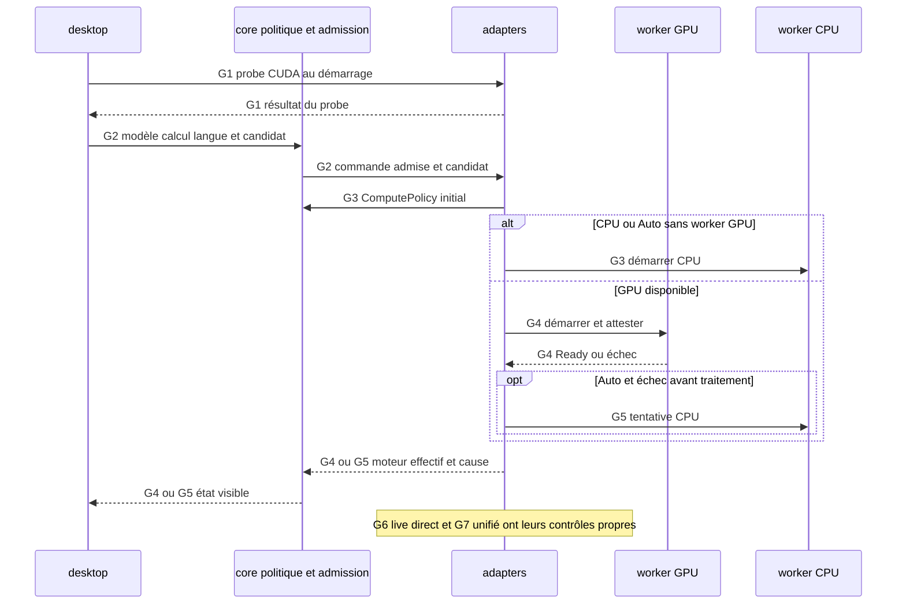

Avancée : parcours principal statique relevé et sourcé.
Blocage : exécution et branches détaillées signalées [Non vérifié].
Décision : les points de rupture restent explicites.

# Choix CPU, GPU et Auto

## Point d’entrée

Les contrôles UI présentent les options calcul/GPU ; dispatch détermine la commande et transmet le candidat. `crates/whisper-desktop/src/ui/model/view/settings.rs:106-165` ; `crates/whisper-desktop/src/ui/model/controller.rs:142-201`.

## Appels, données et branches

| Étape | Parcours constaté | Sources |
| --- | --- | --- |
| G1 | Au démarrage compose lance un probe CUDA et retourne initialement Cpu avec message de vérification ; le contrôleur traite ensuite le résultat et les préférences reçues. | `crates/whisper-desktop/src/root.rs:43-319` ; `crates/whisper-desktop/src/ui/model/controller.rs:6-34` ; `crates/whisper-desktop/src/ui/presentation/selection.rs:22-33` |
| G2 | Le desktop résout les préférences et l’identité du GPU, puis transmet SetGpuCandidate avant la commande ; l’admission contrôle modèle, calcul et langue. | `crates/whisper-desktop/src/ui/model/controller.rs:142-201` ; `crates/whisper-desktop/src/root.rs:721-762` ; `crates/whisper-core/src/gpu_selection.rs:62-143` ; `crates/whisper-core/src/model_selection_app.rs:88-108` |
| G3 | Turbo WorkerPaths::select s’appuie sur la présence du worker GPU et ComputePolicy::initial. CPU est fixe ; Auto tente GPU si présent, sinon CPU ; GPU manuel absent est une erreur. | `crates/whisper-adapters/src/supervisor.rs:41-56` ; `crates/whisper-core/src/compute_policy.rs:30-41` |
| G4 | Le runtime lance/réutilise le worker et envoie StartImport/StartGpuImport ; le worker GPU charge CUDA, vérifie son identité et émet les événements d’attestation. | `crates/whisper-adapters/src/worker_ipc/runtime/import/worker_start.rs:20-188` ; `crates/whisper-worker-gpu/src/native_engine.rs:39-63` ; `crates/whisper-worker-gpu/src/gpu_attestation.rs:3-40` ; `crates/whisper-worker-gpu/src/session/import.rs:2-371` |
| G5 | Les erreurs de lancement/commande CUDA sous Auto peuvent relancer CPU ; les échecs worker sont examinés selon startup_ready et le mode demandé. La politique distingue explicitement audio commencé et échec avant traitement. | `crates/whisper-adapters/src/worker_ipc/runtime/import/worker_start.rs:20-188` ; `crates/whisper-adapters/src/worker_ipc/runtime/import/worker_start.rs:494-664` ; `crates/whisper-core/src/compute_policy.rs:44-55` |
| G6 | Turbo direct conserve la préférence Auto séparément du backend effectif ; il vérifie la preuve GPU et peut replier avant ready. | `crates/whisper-adapters/src/direct_live.rs:97-250` ; `crates/whisper-adapters/src/direct_live/worker.rs:264-280` ; `crates/whisper-adapters/src/direct_live/worker.rs:219-245` |
| G7 | Parakeet unifié résout les routes personnelles, modèle/langue et candidat courant ; Auto peut replier sur CPU lors des validations ou de l’initialisation avant disponibilité/appel en vol. | `crates/whisper-adapters/src/worker_ipc/backends/native.rs:50-135` ; `crates/whisper-adapters/src/worker_ipc/backends/native.rs:38-48` ; `crates/whisper-adapters/src/worker_ipc/runtime/poll_unified.rs:32-221` |

## Processus et threads

Les commandes sont émises depuis le processus desktop. AsyncImportIo crée un thread de service principal et un thread de service de finalisation automatique ; leurs canaux effets/arrêts/événements sont bornés. `crates/whisper-adapters/src/worker_ipc/service/mod.rs:177-256`.

ChildWorkerTransport lance un processus enfant et trois threads pour stderr, stdin et stdout. `crates/whisper-adapters/src/worker_ipc/ipc/mod.rs:56-143`. Le worker Turbo démarre un thread lecteur stdin puis exécute les sessions sur sa boucle principale. `crates/whisper-worker-cpu/src/startup.rs:17-43` ; `crates/whisper-worker-gpu/src/startup.rs:14-39`.

Les probes/catalogues ont leurs threads de collecte dans le processus desktop. `crates/whisper-desktop/src/root.rs:43-319` ; `crates/whisper-adapters/src/gpu_inventory.rs:99-229`.

## Séquence Mermaid

Les identifiants des messages renvoient aux étapes sourcées ci-dessus. Les échanges entre processus sont des messages IPC. Le diagramme représente le parcours décrit, pas tous les cas d’échec.

## Points de rupture et limites

[Non vérifié] Lecture statique seulement : aucun processus produit, microphone, modèle, GPU ou fenêtre lancé. L’entrée dans les moteurs natifs constitue une frontière : leurs appels internes et threads ne sont pas suivis.

[Non vérifié] Aucun GPU compatible ou gain de performance attesté par cette lecture. La présence du fichier worker en G3 n’est pas présentée comme une preuve de compatibilité matérielle. Le détail complet de toutes les erreurs d’initialisation et des sessions simultanées Parakeet n’est pas déroulé.
