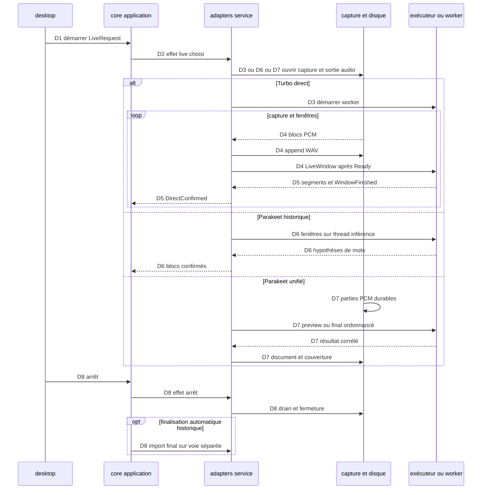

Avancée : parcours principal statique relevé et sourcé.
Blocage : exécution et branches détaillées signalées [Non vérifié].
Décision : les points de rupture restent explicites.

# Transcription microphone en direct

## Point d’entrée

start_live construit LiveRequest avec source, gain, modèle et calcul. Le candidat Parakeet unifié utilise StartUnifiedLiveConfigured ; les autres choix passent par StartDirectLiveConfigured. `crates/whisper-desktop/src/ui/model/controller/actions.rs:222-305`.

## Appels, données et branches

| Étape | Parcours constaté | Sources |
| --- | --- | --- |
| D1 | Le contrôleur vérifie la source microphone et construit la commande ; le cœur admet le modèle puis émet StartDirectLive ou StartUnifiedLive. | `crates/whisper-desktop/src/ui/model/controller/actions.rs:307-352` ; `crates/whisper-desktop/src/ui/model/controller/actions.rs:222-305` ; `crates/whisper-core/src/application/runtime/commands.rs:92-140` ; `crates/whisper-core/src/application/runtime/live.rs:570-646` ; `crates/whisper-core/src/application/runtime/unified.rs:979-1090` |
| D2 | Le service route StartDirectLive vers Turbo DirectLive ou ParakeetLive selon le modèle ; StartUnifiedLive rejoint la capture unifiée et ses conditions d’admission. | `crates/whisper-adapters/src/worker_ipc/runtime/effects.rs:4-236` ; `crates/whisper-adapters/src/worker_ipc/runtime/live.rs:1082-1168` ; `crates/whisper-adapters/src/worker_ipc/runtime/live.rs:1169-1244` |
| D3 | Turbo DirectLive démarre/réutilise le worker, ouvre capture et convertisseur PCM, démarre le probe et crée WavOutput. La capture n’attend pas l’événement Ready du worker pour être possédée par la session. | `crates/whisper-adapters/src/direct_live.rs:97-250` ; `crates/whisper-adapters/src/capture.rs:385-409` ; `crates/whisper-adapters/src/direct_live/wav.rs:27-44` |
| D4 | DirectLive::poll draine la capture vers le WAV et le tampon ; send_next attend worker_ready puis envoie une fenêtre LiveWindow ou Stop lorsque la session est drainée. | `crates/whisper-adapters/src/direct_live.rs:304-357` ; `crates/whisper-adapters/src/direct_live/capture.rs:39-105` ; `crates/whisper-adapters/src/direct_live.rs:359-402` |
| D5 | Le worker transcrit les fenêtres et émet les segments/WindowFinished ; handle_worker confirme la fenêtre, expose DirectConfirmed puis écrit les exports à l’arrêt. | `crates/whisper-worker-cpu/src/session/live.rs:4-254` ; `crates/whisper-worker-gpu/src/session/live.rs:3-254` ; `crates/whisper-adapters/src/direct_live/worker.rs:4-213` ; `crates/whisper-adapters/src/direct_live/outputs.rs:32-118` |
| D6 | Parakeet historique ouvre capture/parties audio et démarre un thread d’inférence ; les fenêtres sont soumises, les mots corrélés puis confirmés via ConfirmationTracker. | `crates/whisper-adapters/src/parakeet_live/lifecycle.rs:23-158` ; `crates/whisper-adapters/src/parakeet_live/windows.rs:27-109` ; `crates/whisper-adapters/src/parakeet_live/inference.rs:17-366` ; `crates/whisper-adapters/src/parakeet_live/events.rs:4-237` ; `crates/whisper-adapters/src/parakeet_confirmation.rs:176-329` |
| D7 | Unifié : la capture alimente des parties PCM et un document ; poll_unified_sessions ordonnance preview/final, l’exécuteur traite les fenêtres et engage leurs résultats dans le document. | `crates/whisper-adapters/src/worker_ipc/runtime/live.rs:105-200` ; `crates/whisper-adapters/src/parakeet_live/capture.rs:139-182` ; `crates/whisper-adapters/src/worker_ipc/runtime/poll_unified.rs:382-1373` ; `crates/whisper-adapters/src/parakeet_pipeline.rs:284-295` |
| D8 | L’arrêt draine capture/écriture. Parakeet historique peut déclencher une transcription finale automatique sur une voie de service distincte ; le cœur suit séparément son statut et ses segments. | `crates/whisper-adapters/src/parakeet_live/lifecycle.rs:199-353` ; `crates/whisper-core/src/application/runtime/live.rs:509-568` ; `crates/whisper-core/src/application/runtime/automatic_final.rs:73-102` ; `crates/whisper-adapters/src/worker_ipc/service/mod.rs:411-596` ; `crates/whisper-adapters/src/worker_ipc/service/automatic_final.rs:103-159` |

## Processus et threads

Les commandes sont émises depuis le processus desktop. AsyncImportIo crée un thread de service principal et un thread de service de finalisation automatique ; leurs canaux effets/arrêts/événements sont bornés. `crates/whisper-adapters/src/worker_ipc/service/mod.rs:177-256`.

ChildWorkerTransport lance un processus enfant et trois threads pour stderr, stdin et stdout. `crates/whisper-adapters/src/worker_ipc/ipc/mod.rs:56-143`. Le worker Turbo démarre un thread lecteur stdin puis exécute les sessions sur sa boucle principale. `crates/whisper-worker-cpu/src/startup.rs:17-43` ; `crates/whisper-worker-gpu/src/startup.rs:14-39`.

Parakeet historique démarre son thread d’inférence ; les parties audio ont un thread écrivain. `crates/whisper-adapters/src/parakeet_live/lifecycle.rs:23-158` ; `crates/whisper-adapters/src/parakeet_audio.rs:96-182`. L’unifié possède son exécuteur dédié. `crates/whisper-adapters/src/worker_ipc/parakeet_unified/executor.rs:134-319`. Le probe microphone possède aussi un thread. `crates/whisper-adapters/src/microphone_probe.rs:219-293`.

## Séquence Mermaid

Les identifiants des messages renvoient aux étapes sourcées ci-dessus. Les échanges entre processus sont des messages IPC. Le diagramme représente le parcours décrit, pas tous les cas d’échec.

## Points de rupture et limites

[Non vérifié] Lecture statique seulement : aucun processus produit, microphone, modèle, GPU ou fenêtre lancé. L’entrée dans les moteurs natifs constitue une frontière : leurs appels internes et threads ne sont pas suivis.

[Non vérifié] Latence, continuité réelle et absence de perte non mesurées. La branche historique StartLive existe aussi dans `crates/whisper-adapters/src/worker_ipc/runtime/live.rs:1245-1262` ; son déroulé détaillé se rompt ici. Les étapes D3–D5 décrivent Turbo ; elles ne sont pas attribuées aux sorties Parakeet.
