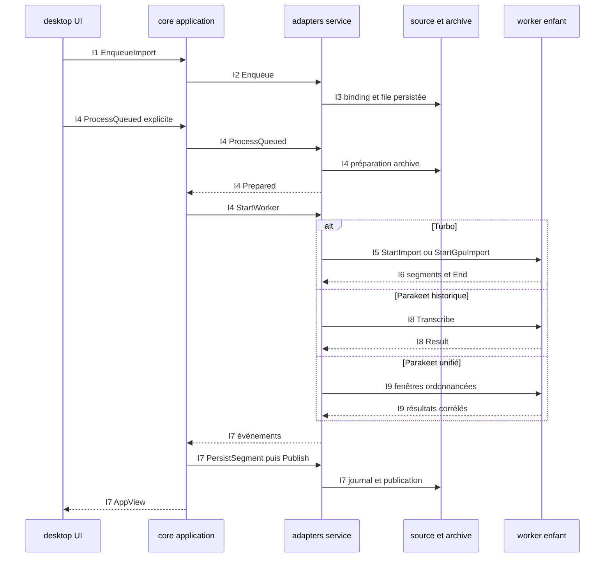

Avancée : parcours principal statique relevé et sourcé.
Blocage : exécution et branches détaillées signalées [Non vérifié].
Décision : les points de rupture restent explicites.

# Import de fichier

## Point d’entrée

L’action UI start_import construit EnqueueImport ; l’action Traiter déclenche ProcessQueued séparément. `crates/whisper-desktop/src/ui/model/controller/actions.rs:61-101` ; `crates/whisper-desktop/src/ui/model/view/queue.rs:4-76`.

## Appels, données et branches

| Étape | Parcours constaté | Sources |
| --- | --- | --- |
| I1 | UI → contrôleur dispatch → garde DesktopAdmissionApplication → ImportApplication::dispatch : vérification modèle/calcul puis émission Enqueue. | `crates/whisper-desktop/src/ui/model/controller/actions.rs:61-101` ; `crates/whisper-desktop/src/ui/model/controller.rs:142-201` ; `crates/whisper-desktop/src/root.rs:721-762` ; `crates/whisper-core/src/application/runtime/commands.rs:92-140` ; `crates/whisper-core/src/application/runtime/queue.rs:359-417` |
| I2 | AsyncImportIo::submit → canaux → service_loop → ServiceRuntime::apply_effect → ImportRuntime::effect. | `crates/whisper-adapters/src/worker_ipc/service/mod.rs:411-596` ; `crates/whisper-adapters/src/worker_ipc/service/mod.rs:663-812` ; `crates/whisper-adapters/src/worker_ipc/runtime/support.rs:415-428` ; `crates/whisper-adapters/src/worker_ipc/runtime/effects.rs:4-236` |
| I3 | enqueue vérifie le modèle, acquiert le binding source, réserve la publication et persiste QueueStore::enqueue ; une branche demande un choix de doublon. | `crates/whisper-adapters/src/worker_ipc/runtime/queue.rs:4-166` ; `crates/whisper-adapters/src/worker_ipc/runtime/source_binding.rs:4-39` ; `crates/whisper-adapters/src/source_binding.rs:101-338` ; `crates/whisper-adapters/src/queue_store.rs:219-246` |
| I4 | Traiter → ProcessQueued → validation FIFO et identité → préparation ArchiveStore → statut Running et événement Prepared. Le cœur transforme Prepared en StartWorker. | `crates/whisper-desktop/src/ui/model/view/queue.rs:4-76` ; `crates/whisper-core/src/application/runtime/import.rs:423-514` ; `crates/whisper-adapters/src/worker_ipc/runtime/queue.rs:192-409` ; `crates/whisper-adapters/src/archive/import.rs:201-217` ; `crates/whisper-core/src/application/runtime/import.rs:26-70` |
| I5 | Turbo : start_worker_effect choisit la route, start_worker_with_candidate_override sélectionne ou réutilise le processus puis envoie StartImport/StartGpuImport. | `crates/whisper-adapters/src/worker_ipc/runtime/import.rs:659-704` ; `crates/whisper-adapters/src/worker_ipc/runtime/import/worker_start.rs:20-188` ; `crates/whisper-adapters/src/worker_ipc/ipc/mod.rs:56-143` |
| I6 | Worker : startup → worker::run → run_session → run_import ; vérification SHA-256, moteur en cache, decoder partagé et transcribe natif ; émission des segments puis End. | `crates/whisper-worker-cpu/src/worker.rs:5-31` ; `crates/whisper-worker-cpu/src/session/mod.rs:47-169` ; `crates/whisper-worker-cpu/src/session/import.rs:4-293` ; `crates/whisper-worker-common/src/decoder.rs:64-143` ; `crates/whisper-worker-cpu/src/native_engine.rs:56-195` ; `crates/whisper-worker-gpu/src/session/import.rs:2-371` |
| I7 | Retour : transport → poll du runtime → canaux événements → poll_once du cœur → persistance de segments et publication quand les acquittements et End concordent. | `crates/whisper-adapters/src/worker_ipc/runtime/poll.rs:134-1231` ; `crates/whisper-core/src/application/runtime/poll.rs:4-44` ; `crates/whisper-core/src/application/runtime/import.rs:142-198` ; `crates/whisper-core/src/application/runtime/import.rs:306-325` |
| I8 | Parakeet historique : start_parakeet_worker crée ParakeetProcess et transmet ses demandes ; la boucle poll_parakeet_worker gère résultats et fenêtres VAD. | `crates/whisper-adapters/src/worker_ipc/runtime/import/worker_start.rs:190-450` ; `crates/whisper-adapters/src/parakeet_import.rs:400-518` ; `crates/whisper-adapters/src/worker_ipc/runtime/poll/parakeet.rs:506-995` |
| I9 | Parakeet unifié : start_controlled_unified_import décode la source en parties et construit finaliseur/document ; poll_unified_sessions ordonnance les fenêtres et l’exécuteur appelle le worker natif via ParakeetProcess. | `crates/whisper-adapters/src/worker_ipc/runtime/import.rs:1115-1251` ; `crates/whisper-adapters/src/parakeet_audio.rs:754-759` ; `crates/whisper-adapters/src/worker_ipc/runtime/poll_unified.rs:382-1373` ; `crates/whisper-adapters/src/worker_ipc/parakeet_unified/executor.rs:134-319` ; `crates/whisper-adapters/src/worker_ipc/parakeet_unified/native.rs:283-464` |

## Processus et threads

Les commandes sont émises depuis le processus desktop. AsyncImportIo crée un thread de service principal et un thread de service de finalisation automatique ; leurs canaux effets/arrêts/événements sont bornés. `crates/whisper-adapters/src/worker_ipc/service/mod.rs:177-256`.

ChildWorkerTransport lance un processus enfant et trois threads pour stderr, stdin et stdout. `crates/whisper-adapters/src/worker_ipc/ipc/mod.rs:56-143`. Le worker Turbo démarre un thread lecteur stdin puis exécute les sessions sur sa boucle principale. `crates/whisper-worker-cpu/src/startup.rs:17-43` ; `crates/whisper-worker-gpu/src/startup.rs:14-39`.

Le chemin unifié utilise un thread d’inférence supplémentaire. `crates/whisper-adapters/src/worker_ipc/parakeet_unified/executor.rs:134-319`.

## Séquence Mermaid

Les identifiants des messages renvoient aux étapes sourcées ci-dessus. Les échanges entre processus sont des messages IPC. Le diagramme représente le parcours décrit, pas tous les cas d’échec.

## Points de rupture et limites

[Non vérifié] Lecture statique seulement : aucun processus produit, microphone, modèle, GPU ou fenêtre lancé. L’entrée dans les moteurs natifs constitue une frontière : leurs appels internes et threads ne sont pas suivis.

[Non vérifié] Le flux se rompt à CpuEngine/GpuEngine::transcribe et au moteur Parakeet natif. Les branches complètes de VAD, doublon, annulation et reprise ne sont pas toutes déroulées. La persistance finale est détaillée dans [publication](publication.md).
