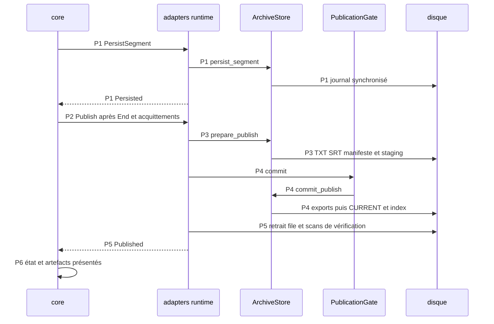

Avancée : parcours principal statique relevé et sourcé.
Blocage : exécution et branches détaillées signalées [Non vérifié].
Décision : les points de rupture restent explicites.

# Publication sur disque

## Point d’entrée

Pour l’import, les événements Persisted et End alimentent maybe_publish ; le cœur ne soumet Publish que lorsque les segments attendus sont acquittés. `crates/whisper-core/src/application/runtime/import.rs:142-198` ; `crates/whisper-core/src/application/runtime/import.rs:306-325`.

## Appels, données et branches

| Étape | Parcours constaté | Sources |
| --- | --- | --- |
| P1 | PersistSegment passe du cœur au runtime puis au journal ArchiveStore ; Persisted est renvoyé après la persistance. | `crates/whisper-core/src/application/runtime/import.rs:327-347` ; `crates/whisper-adapters/src/worker_ipc/runtime/import.rs:175-241` ; `crates/whisper-adapters/src/archive/journal.rs:7-39` |
| P2 | End et les acquittements déclenchent Publish ; le runtime sélectionne l’archive de la session et sa PublicationGate. | `crates/whisper-core/src/application/runtime/import.rs:306-325` ; `crates/whisper-adapters/src/worker_ipc/runtime/import.rs:243-277` |
| P3 | prepare_publish vérifie le nombre de segments et la source segmentée éventuelle, écrit transcript.txt/transcript.srt, crée et relit manifest.json et prépare les exports. | `crates/whisper-adapters/src/archive/publication.rs:31-133` ; `crates/whisper-adapters/src/archive/storage.rs:3-31` ; `crates/whisper-adapters/src/archive/storage.rs:50-66` |
| P4 | PublicationGate::commit arbitre l’engagement ; commit_publish installe les exports, écrit CURRENT et applique les intentions de publication. | `crates/whisper-adapters/src/worker_ipc/runtime/import.rs:279-417` ; `crates/whisper-adapters/src/worker_ipc/publication/mod.rs:46-69` ; `crates/whisper-adapters/src/archive/publication.rs:135-280` ; `crates/whisper-adapters/src/archive/publication/exports.rs:20-48` |
| P5 | Le runtime retire l’entrée de file, relit l’archive deux fois et vérifie la génération complète, libère le binding source puis émet Published. | `crates/whisper-adapters/src/worker_ipc/runtime/import.rs:279-417` ; `crates/whisper-adapters/src/queue_store.rs:452-502` ; `crates/whisper-adapters/src/source_binding.rs:574-598` |
| P6 | Les cartes import/unifiées sont actualisées depuis Published et les artefacts ; le mécanisme de retrait des traitements remplacés est distinct de la transaction principale. | `crates/whisper-core/src/application/runtime/import.rs:200-304` ; `crates/whisper-core/src/application/runtime/unified.rs:665-692` ; `crates/whisper-adapters/src/archive/cleanup.rs:15-60` ; `crates/whisper-adapters/src/archive/cleanup/execution.rs:27-540` |
| P7 | Sorties live distinctes : DirectLive écrit TXT/SRT à côté du WAV ; Parakeet historique possède ses exports et son JSON compagnon ; LiveArchive publie MP3/texte/SRT/manifestes selon un autre chemin. | `crates/whisper-adapters/src/direct_live/outputs.rs:32-118` ; `crates/whisper-adapters/src/direct_live/outputs.rs:211-256` ; `crates/whisper-adapters/src/archive/live.rs:463-642` |

## Processus et threads

Les commandes sont émises depuis le processus desktop. AsyncImportIo crée un thread de service principal et un thread de service de finalisation automatique ; leurs canaux effets/arrêts/événements sont bornés. `crates/whisper-adapters/src/worker_ipc/service/mod.rs:177-256`.

La publication import s’exécute dans le runtime de service et ses opérations disque ; le worker a déjà émis ses segments/End. `crates/whisper-adapters/src/worker_ipc/runtime/import.rs:279-417`. La finalisation automatique dispose de son propre thread et installe les exports via un staging dédié. `crates/whisper-adapters/src/worker_ipc/service/mod.rs:177-256` ; `crates/whisper-adapters/src/worker_ipc/service/automatic_final.rs:285-320`.

## Séquence Mermaid

Les identifiants des messages renvoient aux étapes sourcées ci-dessus. Les échanges entre processus sont des messages IPC. Le diagramme représente le parcours décrit, pas tous les cas d’échec.

## Points de rupture et limites

[Non vérifié] Lecture statique seulement : aucun processus produit, microphone, modèle, GPU ou fenêtre lancé. L’entrée dans les moteurs natifs constitue une frontière : leurs appels internes et threads ne sont pas suivis.

[Non vérifié] L’ordre cité est celui des appels Rust ; résistance réelle aux coupures, atomicité du système de fichiers, comportement des liens physiques et cas de rollback partiel non testés. Le diagramme couvre P1–P6 import, pas les transactions live P7.
