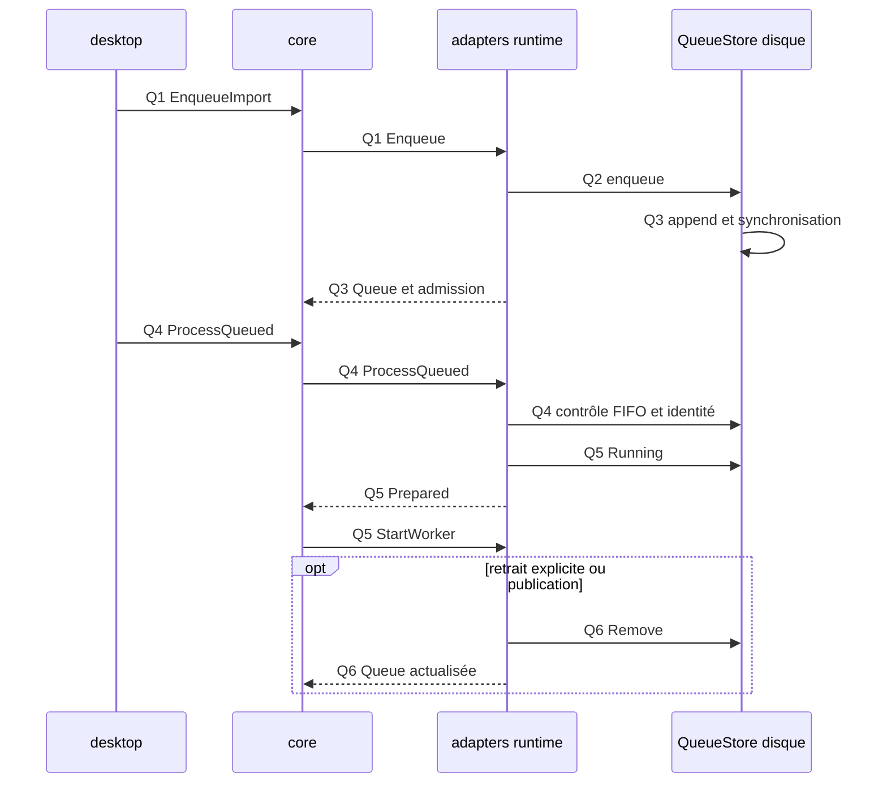

Avancée : parcours principal statique relevé et sourcé.
Blocage : exécution et branches détaillées signalées [Non vérifié].
Décision : les points de rupture restent explicites.

# File d’attente persistée

## Point d’entrée

Ajout : start_import → EnqueueImport. Consommation : bouton Traiter → ProcessQueued. `crates/whisper-desktop/src/ui/model/controller/actions.rs:61-101` ; `crates/whisper-desktop/src/ui/model/view/queue.rs:4-76`.

## Appels, données et branches

| Étape | Parcours constaté | Sources |
| --- | --- | --- |
| Q1 | EnqueueImport passe par l’admission du modèle puis le cœur soumet Enqueue sans démarrage worker immédiat. | `crates/whisper-core/src/application/runtime/commands.rs:92-140` ; `crates/whisper-core/src/application/runtime/queue.rs:359-417` |
| Q2 | Le service acquiert la source, contrôle doublons/réservations puis ajoute la requête durable. | `crates/whisper-adapters/src/worker_ipc/runtime/queue.rs:4-166` ; `crates/whisper-adapters/src/queue_store.rs:219-246` |
| Q3 | QueueStore écrit les opérations du journal puis les rejoue dans son index ; la file est renvoyée par ImportEvent::Queue. | `crates/whisper-adapters/src/queue_store.rs:504-516` ; `crates/whisper-adapters/src/queue_store.rs:518-558` ; `crates/whisper-adapters/src/worker_ipc/runtime/queue.rs:4-166` |
| Q4 | Le clic Traiter est refusé si un travail est actif côté cœur ; le service vérifie que l’identité demandée est la première de la file et prépare son archive. | `crates/whisper-core/src/application/runtime/import.rs:423-514` ; `crates/whisper-adapters/src/worker_ipc/runtime/queue.rs:192-409` |
| Q5 | La préparation passe l’entrée à Running et émet Prepared ; le cœur demande alors StartWorker. | `crates/whisper-adapters/src/worker_ipc/runtime/queue.rs:192-409` ; `crates/whisper-core/src/application/runtime/import.rs:26-70` |
| Q6 | Retirer émet RemoveQueued ; la publication réussie retire aussi l’entrée et renvoie la file actualisée. | `crates/whisper-desktop/src/ui/model/view/queue.rs:4-76` ; `crates/whisper-adapters/src/worker_ipc/runtime/queue.rs:167-191` ; `crates/whisper-adapters/src/worker_ipc/runtime/import.rs:279-417` |

## Processus et threads

Les commandes sont émises depuis le processus desktop. AsyncImportIo crée un thread de service principal et un thread de service de finalisation automatique ; leurs canaux effets/arrêts/événements sont bornés. `crates/whisper-adapters/src/worker_ipc/service/mod.rs:177-256`.

Le journal est manipulé dans le runtime de service ; le processus worker rejoint le [flux import](import.md) après Prepared. `crates/whisper-adapters/src/worker_ipc/runtime/queue.rs:192-409`.

## Séquence Mermaid

Les identifiants des messages renvoient aux étapes sourcées ci-dessus. Les échanges entre processus sont des messages IPC. Le diagramme représente le parcours décrit, pas tous les cas d’échec.

## Points de rupture et limites

[Non vérifié] Lecture statique seulement : aucun processus produit, microphone, modèle, GPU ou fenêtre lancé. L’entrée dans les moteurs natifs constitue une frontière : leurs appels internes et threads ne sont pas suivis.

[Non vérifié] Les séquences complètes des conflits de doublon et des erreurs de journal ne sont pas déroulées. La voie de finalisation automatique possède ses propres canaux/files ; elle ne doit pas être confondue avec cette file utilisateur. `crates/whisper-adapters/src/worker_ipc/service/mod.rs:177-256` ; `crates/whisper-adapters/src/worker_ipc/service/mod.rs:411-596`.
