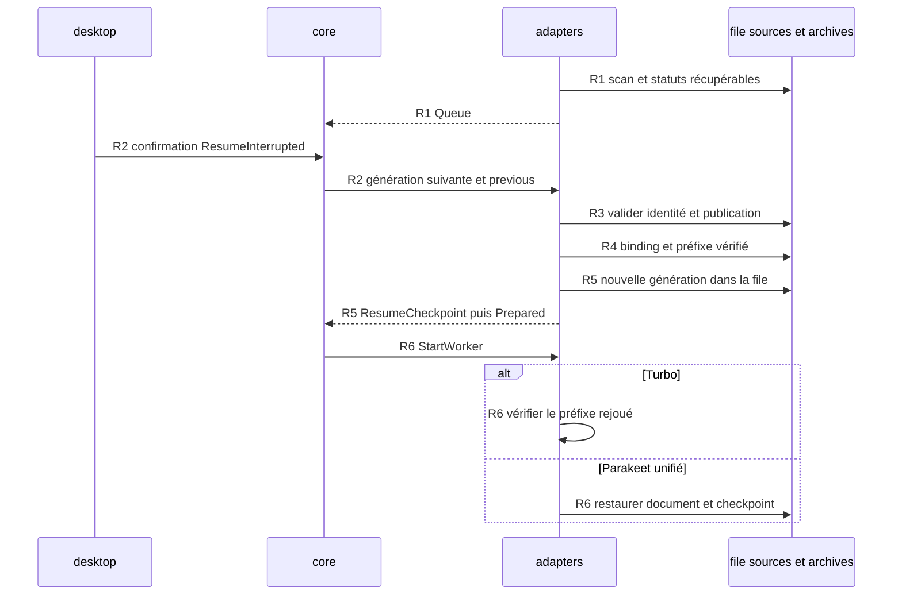

Avancée : parcours principal statique relevé et sourcé.
Blocage : exécution et branches détaillées signalées [Non vérifié].
Décision : les points de rupture restent explicites.

# Reprise après interruption

## Point d’entrée

queue_ui affiche Reprendre… puis Confirmer la reprise pour les entrées Interrupted ; ResumeInterrupted ne part qu’après confirmation. `crates/whisper-desktop/src/ui/model/view/queue.rs:4-76`.

## Appels, données et branches

| Étape | Parcours constaté | Sources |
| --- | --- | --- |
| R1 | Le scan recovery ouvre file et archives, retire les entrées terminées et transforme Running en Interrupted, Queued en AwaitingChoice ; il ne lance pas le worker. | `crates/whisper-adapters/src/recovery.rs:15-45` ; `crates/whisper-adapters/src/worker_ipc/runtime/queue.rs:410-422` |
| R2 | Le cœur reçoit ResumeInterrupted, construit la génération suivante et soumet l’effet avec l’identité précédente. | `crates/whisper-desktop/src/ui/model/view/queue.rs:4-76` ; `crates/whisper-core/src/application/runtime/import.rs:423-514` |
| R3 | Le runtime valide modèle/source/file et peut exiger une reconfirmation de publication ou un choix de doublon. | `crates/whisper-adapters/src/worker_ipc/runtime/recovery.rs:9-349` ; `crates/whisper-adapters/src/queue_store.rs:390-422` |
| R4 | Le binding source est transféré puis ArchiveStore::resume_from_with_qualification vérifie l’archive/préfixe et prépare la nouvelle génération. | `crates/whisper-adapters/src/worker_ipc/runtime/source_binding.rs:86-95` ; `crates/whisper-adapters/src/archive/recovery.rs:39-312` ; `crates/whisper-adapters/src/archive/journal.rs:63-77` |
| R5 | La file de reprise est mise à jour ; le runtime conserve resume_prefix et le checkpoint unifié éventuel puis émet ResumeCheckpoint et Prepared. | `crates/whisper-adapters/src/worker_ipc/runtime/recovery.rs:9-349` ; `crates/whisper-adapters/src/queue_store.rs:316-340` ; `crates/whisper-core/src/application/runtime/import.rs:26-70` |
| R6 | Turbo suit StartWorker et le contrôle du préfixe dans poll ; Parakeet unifié restaure document/checkpoint avant l’ordonnancement. | `crates/whisper-adapters/src/worker_ipc/runtime/poll.rs:134-1231` ; `crates/whisper-adapters/src/worker_ipc/runtime/import.rs:1115-1251` ; `crates/whisper-adapters/src/worker_ipc/parakeet_unified/mod.rs:25-103` |
| R7 | Le live a un scan distinct des préfixes confirmés et de la publication ; les reprises live et retraits de remplacement n’utilisent pas tous ResumeInterrupted. | `crates/whisper-adapters/src/archive/recovery/live.rs:185-293` ; `crates/whisper-adapters/src/archive/live.rs:648-713` ; `crates/whisper-adapters/src/archive/cleanup.rs:62-80` |

## Processus et threads

Les commandes sont émises depuis le processus desktop. AsyncImportIo crée un thread de service principal et un thread de service de finalisation automatique ; leurs canaux effets/arrêts/événements sont bornés. `crates/whisper-adapters/src/worker_ipc/service/mod.rs:177-256`.

Après Prepared, le transport relance ou réutilise un worker selon le flux import. `crates/whisper-adapters/src/worker_ipc/runtime/import/worker_start.rs:20-188`.

## Séquence Mermaid

Les identifiants des messages renvoient aux étapes sourcées ci-dessus. Les échanges entre processus sont des messages IPC. Le diagramme représente le parcours décrit, pas tous les cas d’échec.

## Points de rupture et limites

[Non vérifié] Lecture statique seulement : aucun processus produit, microphone, modèle, GPU ou fenêtre lancé. L’entrée dans les moteurs natifs constitue une frontière : leurs appels internes et threads ne sont pas suivis.

[Non vérifié] La reprise après coupure électrique, toutes les corruptions et tous les états de publication partielle ne sont pas exécutés. Rupture au contrôle natif des segments recalculés ; le schéma R2–R6 décrit l’import, les autres mécanismes sont seulement localisés en R7.
