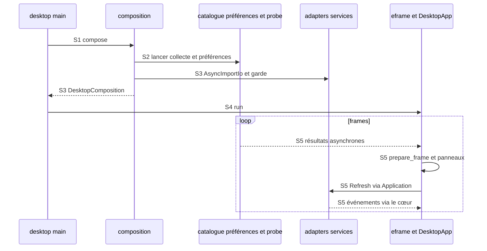

Avancée : parcours principal statique relevé et sourcé.
Blocage : exécution et branches détaillées signalées [Non vérifié].
Décision : les points de rupture restent explicites.

# Démarrage et composition

## Point d’entrée

Le binaire main appelle root::compose puis whisper_desktop::run. `crates/whisper-desktop/src/main.rs:5-33`.

## Appels, données et branches

| Étape | Parcours constaté | Sources |
| --- | --- | --- |
| S1 | compose choisit les racines modèle/settings/workers selon le profil, puis ouvre les canaux catalogue/admission/préférences. | `crates/whisper-desktop/src/root.rs:43-319` ; `crates/whisper-desktop/src/root.rs:387-405` |
| S2 | Un thread inspecte le catalogue et recontrôle les ressources ; un autre prend en charge les préférences ; le probe GPU démarre en tâche de fond. | `crates/whisper-desktop/src/root.rs:43-319` ; `crates/whisper-adapters/src/model_catalog.rs:247-259` ; `crates/whisper-adapters/src/worker_ipc/backends/mod.rs:21-52` |
| S3 | La route unifiée native est activée par personal-install et WHISPER_PARAKEET_UNIFIED_NATIVE_CANDIDATE=1 ; compose construit AsyncImportIo et la garde Application. | `crates/whisper-desktop/src/root.rs:43-319` ; `crates/whisper-desktop/src/root.rs:576-619` |
| S4 | run ouvre eframe::run_native/Glow et construit DesktopApp avec chemins, microphones, probe, catalogue et préférences. | `crates/whisper-desktop/src/lib.rs:18-56` ; `crates/whisper-desktop/src/ui/model.rs:189-276` |
| S5 | Chaque frame prépare l’état, draine les entrées et rafraîchit Application ; les panneaux UI affichent les états/notifications et les jalons de rendu sont journalisés. | `crates/whisper-desktop/src/ui/model/view.rs:31-50` ; `crates/whisper-desktop/src/ui/model/controller.rs:231-312` ; `crates/whisper-desktop/src/ui/model/controller.rs:314-353` ; `crates/whisper-desktop/src/ui/model/controller/observability.rs:27-40` |

## Processus et threads

Les commandes sont émises depuis le processus desktop. AsyncImportIo crée un thread de service principal et un thread de service de finalisation automatique ; leurs canaux effets/arrêts/événements sont bornés. `crates/whisper-adapters/src/worker_ipc/service/mod.rs:177-256`.

Les créations de threads catalogue, préférences et probe sont dans compose. `crates/whisper-desktop/src/root.rs:43-319`. Le journal de réactivité utilise un thread écrivain séparé. `crates/whisper-desktop/src/reactivity_log.rs:29-65`.

## Séquence Mermaid

Les identifiants des messages renvoient aux étapes sourcées ci-dessus. Les échanges entre processus sont des messages IPC. Le diagramme représente le parcours décrit, pas tous les cas d’échec.

## Points de rupture et limites

[Non vérifié] Lecture statique seulement : aucun processus produit, microphone, modèle, GPU ou fenêtre lancé. L’entrée dans les moteurs natifs constitue une frontière : leurs appels internes et threads ne sont pas suivis.

[Non vérifié] Délai avant première frame, blocages du pilote, initialisation du toolkit et performances de démarrage non mesurés. La frontière de cette lecture est eframe::run_native et les retours asynchrones des ressources natives.
